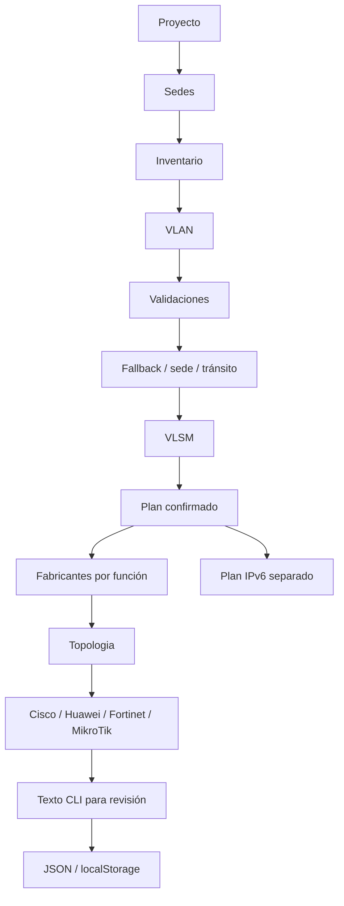

# Documentación del código — revisión integral WAN Architect

## Cómo estudiar esta aplicación

La aplicación sigue siendo un solo archivo autónomo, `WAN_v4.html`. HTML define la estructura; CSS la presentación; JavaScript valida datos, calcula redes, renderiza vistas y genera propuestas de comandos. No hay backend, ejecución remota ni conexión obligatoria. El botón Generar produce texto para revisión humana: nunca configura equipos.

Base de esta revisión: `1956d1872363c88399f5e8240abb1d7a13bca340`. Lea primero las reglas de [AGENTS.md](../AGENTS.md), el [estado](estado-proyecto.md) y las [pruebas](pruebas.md). Las líneas cambian al documentar: busque el nombre de función, no un número de línea histórico.

## Estado confirmado y presentación temporal

`state` es el proyecto confirmado. `state.version` sigue siendo 4; los contratos v2/v3 migran a v4 sin reasignar redes. `project.base` es el **fallback**, no un contenedor obligatorio de todas las sedes. `sites[].ipv4Base` es un pool privado independiente. `project.transitBase`, si existe, separa los enlaces /30. Si una sede no define bloque usa el fallback libre; si no hay tránsito explícito usa ese mismo espacio libre excluyendo todas las LAN y reservas.

Los bloques deben ser RFC1918 completos y estar alineados. `192.168.66.0/22` no es una red alineada: su red es `192.168.64.0/22`. Se rechaza la primera expresión; no se corrige silenciosamente. Los nombres/direcciones de las pruebas son datos ficticios del runner, no valores de sedes introducidos en producción.

`formDrafts`, `inventoryEditing`, `vlanEditing`, `topologyZoom` y la página son presentación temporal. Los borradores sobreviven a navegación y cambio de idioma en la sesión; **no se confunden con datos confirmados guardados en JSON**. Confirmar y luego guardar persiste cantidades reales. La preferencia ES/EN sigue en su clave local independiente, fuera del proyecto.

### Extensiones opcionales de v4

- `sites[].vendorProfile`: `{router, core, distribution, access, firewall, backupRouter}`; cada valor es una cadena de la lista de fabricantes permitidos para su función o vacío.
- `nodes[].autoKey`: asociación estable sede:función:tipo:ordinal para entidades nuevas autogeneradas.
- `nodes[].vendorOverride` / `nameOverride`: booleanos opcionales que conservan la elección individual al regenerar.
- `Genérico`: fabricante sin adaptador para terminales, AP, impresoras, cámaras y servidores; no se permite en router, switch, core o firewall.

El importador acepta proyectos antiguos sin esos campos y no infiere perfiles, autoría automática ni marcas nuevas. Las extensiones pasan por listas/tipos explícitos; no admiten propiedades arbitrarias en perfiles. Un programa antiguo puede rechazar el nuevo valor `Genérico`: la compatibilidad garantizada aquí es **importar los proyectos antiguos en esta versión**, no ejecutar el archivo nuevo en una versión anterior.

## A. Direccionamiento y asignación VLSM

1. `privateIPv4Block()` reutiliza `subnet()` y aritmética IPv4 existente; exige red alineada y contención completa en 10/8, 172.16/12 o 192.168/16.
2. `validateSiteBlocks()` valida fallback, cada pool de sede y tránsito. Solo el pool propio contiene las VLAN de esa sede. Dos sedes nunca se solapan; sede y tránsito tampoco.
3. `allocationPools()` construye un mapa por ID de sede. El fallback puede contener reservas parciales de sedes: estas se excluyen al buscar espacio libre.
4. `manualVlanNetworks()` valida **todas** las subredes manuales antes de reservarlas: pertenencia, capacidad, crecimiento, gateway y solapamientos.
5. `allocate()` reserva manuales, luego redes previas automáticas no afectadas que siguen siendo válidas y /30 reutilizables. Las nuevas solicitudes se ordenan por tamaño y clave estable.
6. `findIPv4Space()` alinea al tamaño del CIDR y salta intervalos reservados; tener IP libres dispersas no garantiza un bloque contiguo.
7. Si no cabe una solicitud, el asignador lanza un error contextual. No amplía ni mueve intenciones manuales ni guarda un plan parcial.
8. `confirmVlans()` adopta el resultado solo tras terminar correctamente. El plan y su orden son estables para la misma entrada y estado previo. Conservar redes previas válidas implica que un proyecto editado puede ocupar huecos diferentes de uno nuevo equivalente; es una decisión explícita de estabilidad, no aleatoriedad.

El cálculo mantiene hosts, crecimiento, reservas (una o tres), gateway automático/manual, máscara, broadcast, `required`, `size` y capacidades. IPv6 conserva su implementación independiente; esta revisión no añade configuración IPv6 por fabricante.

## B. Confirmaciones e invalidación

### Inventario

Sin `counts` se muestra formulario con estimaciones. Confirmar valida todos los campos y usa `counts` como cantidades confirmadas persistidas. Entonces aparece resumen y **Editar inventario**. Editar no destruye el diseño. Restaurar estimación pide confirmación; cancelar no cambia datos. Las fórmulas de `estimated()`, `counts()` y `proposal()` permanecen iguales.

### VLAN

Sin cálculo válido aparece **Pendiente de confirmación**; tras éxito, **VLAN confirmadas** y **Recalcular VLAN**. Escribir valores realmente distintos establece un borrador. No se permite generar dependencias mientras exista ese borrador; sí navegar a calculadora, seguridad u otras vistas independientes y regresar a corregir. Confirmar una entrada idéntica conserva revisión, plan, aprobación, nodos, enlaces y CLI.

### Sedes y dependencias

Guardar una ficha idéntica no invalida. Nombre o ancho de banda no requieren destruir redes; un cambio de nombre retira sus CLI cuando pueden contener comentarios anteriores. Un cambio de bloque invalida las LAN/topología locales; cambios de inventario/estructura requieren reproponer sus VLAN. Las demás VLAN, LAN, /30 válidas y equipos se conservan cuando no dependen del cambio. `proposeVlans()` completa únicamente sedes sin VLAN; «Volver a proponer» permite el reemplazo total explícito. Un bloque nuevo incompatible con un CIDR manual ya guardado se rechaza antes de confirmar la ficha.

`invalidateSite()` y la confirmación diferencial retiran CLI afectadas y las de vecinos cuyo enlace WAN cambió. No se conserva una CLI como válida si ya perdió su interfaz. Las CLI retenidas reciben la revisión vigente. `routerId()` estabiliza los IDs automáticos numéricos `nN` de laboratorio, evitando renumerar otra sede por quitar nodos; IDs personalizados conservan su regla histórica.

Los equipos manuales se conservan al regenerar. Si quedan IP/enlaces incompatibles, deben corregirse con los editores y se bloquean generadores; no se mueven direcciones manuales silenciosamente. La generación de topología valida un candidato completo antes de sustituir entidades.

## C. Topología y fabricantes

El usuario selecciona fabricantes por sede y función **antes de generar**. Router, core, acceso y distribución (si existe) requieren selección explícita. Firewall y router secundario son opcionales; si cambian, se recalculan VLAN para crear sus /30. No se presupone Internet, NAT, VPN ni políticas permisivas.

| Función | Fabricantes admitidos en este adaptador |
| --- | --- |
| Router principal/secundario | Cisco, Huawei, MikroTik |
| Core capa 3 | Cisco, Huawei |
| Distribución/acceso | Cisco, Huawei |
| Firewall opcional | Fortinet |
| Terminales y AP | Genérico; sin CLI propia |

Dos cores redundantes deben usar un mismo fabricante: HSRP y VRRP no forman un grupo interoperable. La mezcla sí se permite entre funciones y sedes. No se certifica interoperabilidad física ni firmware.

`buildTopology()` consume VLAN, /30 e inventario reales, crea claves estables y puertos independientes por marca. IDs se reutilizan al regenerar; equipos manuales permanecen. Los proyectos anteriores carecen de `autoKey`, así que no se presume que un equipo antiguo fuera automático ni se elimina como tal.

`siteCode()` deriva iniciales/números del nombre real, elimina acentos y resuelve colisiones con ID. Los hostnames usan prefijos de función y ordinales; los cambios individuales explícitos se preservan con overrides. No hay nombres de las sedes del enunciado codificados como datos productivos.

`arrangeTopology()` cambia solo coordenadas por sede, nivel, fila y columna. `svgTopology()` dibuja iconos originales inline; enlaces WAN, routed, trunk y access tienen estilos distintos y canales fuera de las cajas. En diagramas densos se omiten etiquetas permanentes de enlace y se consultan con hover/tablas para evitar amontonamientos. La separación automática se comprueba para cajas; el arrastre manual permite que el usuario vuelva a superponer equipos. No se promete resolver todo cruce de enlaces posible.

Zoom limita escala; el contenedor desplaza el dibujo, sin comprimir etiquetas. Se conservan arrastre, editor por clic/Enter, creación de enlaces, carga de imagen local y descarga SVG autónoma. La imagen sigue siendo referencia manual; no OCR.

### Generadores reales y Comparación

`configNodes()` filtra equipos realmente asignados a la marca. El generador Huawei ya no ofrece equipos Cisco como si fueran Huawei. **Comparación** conserva equivalencias explícitas de IOS/VRP, sin cambiar fabricantes del modelo.

Los cuatro adaptadores conservan sus familias de comandos, validadores y políticas anteriores. Cambia la selección real y la precondición de aprobación. `endpoint()` obtiene puerto e IP de los mismos enlaces del modelo. Cambiar una marca individual exige puertos válidos para destino y confirmación; no convierte roles incompatibles. Las configuraciones son IPv4 y revisión textual: no se ejecutan, no demuestran conectividad ni compatibilidad física.

## D. Interfaz retirada sin eliminar cálculos ni entregables

Se retiraron exclusivamente el desplegable explicativo VLSM/CIDR/gateway, el desplegable Interpretación de Subnetting y el módulo Evidencias Corte 2. Hay 13 módulos, índices 0–12; Fortinet 10, MikroTik 11 e IPv6 12. La barra de progreso y navegación usan el mismo arreglo `steps`. Calculadora, resultados, algoritmos, comparación y todos los documentos/capturas académicos permanecen.

## E. Contratos de funciones nuevas o modificadas

Los encabezados de código explican entrada, salida y efectos. Se usan comentarios por bloque para plantillas HTML/SVG: insertar comentarios dentro de atributos, cadenas CLI o expresiones rompería el programa y no se hace. Los cálculos estables no se reescriben para aumentar artificialmente el número de comentarios.

| Función | Entrada | Proceso, salida y efectos |
| --- | --- | --- |
| `invalidateSite()` | ID estable de sede y decisión de conservar sus VLAN. | Filtra dependencias locales y CLI de vecinos WAN; conserva otras sedes y actualiza revisión. |
| `captureDraft()` | Página y controles visibles de sede, inventario o VLAN. | Copia valores/checks en memoria de presentación; no guarda datos sin confirmar en JSON. |
| `restoreDraft()` | Página activa y borradores asociados a su sede. | Restaura solo controles existentes; no cambia el estado confirmado ni dispara eventos. |
| `selectSite()` | Índice elegido en el selector. | Captura primero el formulario anterior, cambia la ficha y vuelve a renderizar. |
| `editCounts()` | Índice de sede con cantidades confirmadas. | Abre el formulario; no invalida hasta confirmar cantidades realmente diferentes. |
| `vlanFormChanged()` | Valores visibles y última intención confirmada. | Devuelve un booleano comparando campos; no parsea, asigna ni guarda entradas. |
| `requireConfirmedPlan()` | Aprobación, plan efectivo y bandera de borrador. | Lanza un error si falta cálculo confirmado; las vistas independientes siguen navegables. |
| `go()` | Índice de módulo solicitado. | Conserva borradores, limita el índice al menú vigente y desplaza al encabezado. |
| `render()` | Estado confirmado, idioma, página y preferencias visuales. | Reconstruye únicamente la vista; restaura borradores y enlaza eventos de esa página. |
| `projectView()` | Proyecto y sede seleccionada. | Devuelve HTML escapado para datos y bloque propio; no escribe estado. |
| `saveSite()` | Ficha visible con nombre, bloque, usuarios y opciones. | Valida una candidata completa; igualdad conserva diseño y cambio real invalida solo dependencias locales. Rechaza nuevos pools incompatibles con intenciones manuales confirmadas. |
| `estimateView()` | Cantidades reales o fórmulas estimadas por sede. | Devuelve formulario o resumen confirmado junto con infraestructura y ancho de banda, sin cambiar fórmulas. |
| `saveCounts()` | Cantidades visibles, dentro de límites numéricos. | Valida todo antes de confirmar; diferencias reales invalidan su sede, cantidades iguales no destruyen diseño. |
| `resetCounts()` | Índice de sede y confirmación nativa del usuario. | Cancelar conserva todo; aceptar retira la personalización y aplica estimación vigente. |
| `vlanView()` | Intenciones, aprobación y último plan efectivo. | Muestra fallback, tránsito, CIDR manual, estado pendiente/confirmado y redes calculadas; no asigna. |
| `addVlan()` | Filas actuales del formulario. | Incorpora primero ediciones válidas y añade una clave nueva; falla sin renderizar si otra fila es inválida. |
| `deleteVlan()` | Índice elegido y confirmación del usuario. | Lee todas las filas antes de eliminar una; conserva texto ante validación fallida e invalida el plan dependiente. |
| `readVlans()` | Controles de cada VLAN y opciones de direccionamiento visibles. | Devuelve candidatas validadas; comprueba IDs, gestión e intenciones manuales sin sustituir estado. |
| `initialTransits()` | Sedes, redundancia, interconexión y perfiles opcionales. | Devuelve solicitudes /30 por clave estable, incluidos firewall y router secundario; no inventa Internet. |
| `allocationPools()` | Fallback candidato, proyecto y lista de sedes. | Devuelve pools numéricos independientes y reservas; valida RFC1918, alineación y separación. |
| `allocate()` | VLAN candidatas, fallback, crecimiento, solicitudes de tránsito y proyecto candidato. | Reserva manuales y redes no afectadas válidas; busca huecos CIDR en cada pool y devuelve un plan completo o lanza error. |
| `confirmVlans()` | Formulario visible y último diseño confirmado. | Calcula antes de guardar; error conserva todo, igualdad mantiene aprobación y cambios invalidan dependencias diferenciales. |
| `planTable()` | Filas efectivas del plan. | Devuelve tabla de redes/gateways/capacidad y origen manual o automático; no confunde intención con resultado. |
| `subnetView()` | Último cálculo y plan IPv4/IPv6. | Devuelve resultados completos sin el desplegable retirado; las funciones matemáticas permanecen separadas. |
| `vendorProfile()` | Sede, con o sin perfil heredado. | Devuelve las seis funciones con cadenas explícitas; vacío significa que debe elegir, no Cisco implícito. |
| `validateVendorProfile()` | Objeto opcional recibido del formulario o JSON. | Rechaza claves y combinaciones ajenas a la lista permitida; devuelve una copia conocida. |
| `vendorProfilesView()` | Perfiles de todas las sedes. | Devuelve selectores por función, incluyendo opcionales; no convierte firewalls en switches. |
| `saveVendorProfiles()` | Todos los selectores de fabricantes. | Valida en conjunto, pide confirmación ante equipos existentes y exige recalcular si cambian tránsitos. |
| `validateNodeVendor()` | Tipo y fabricante de un equipo candidato. | Bloquea roles no implementados: Fortinet solo firewall, MikroTik solo router y Genérico solo terminal. |
| `buildTopology()` | Plan confirmado, inventario, perfiles y entidades existentes. | Valida perfiles/capacidad; genera por clave, conserva IDs y manuales, prueba el candidato completo y solo después lo adopta. |
| `siteCode()` | Nombre real de sede e ID estable. | Normaliza caracteres, deriva iniciales/números y agrega ID solo cuando hay colisión entre sedes. |
| `arrangeTopology()` | Equipos existentes y opción de renderizar. | Ordena por sede, jerarquía e ID; cambia únicamente coordenadas y nunca borra entidades. |
| `zoomTopology()` | Factor solicitado por botones. | Limita escala entre 0,25 y 3; modifica solo ancho visual del SVG, sin cambiar coordenadas del modelo. |
| `deviceIcon()` | Tipo de equipo de la lista permitida. | Devuelve trazados SVG originales embebidos; no utiliza fuentes, Internet ni recursos protegidos. |
| `svgTopology()` | Nodos, enlaces, posiciones y plan actual. | Devuelve SVG autónomo con iconos, carriles, títulos y detalles escapados; sirve para pantalla y descarga. |
| `editNode()` | ID existente o cadena vacía para alta manual. | Abre un editor; altas requieren elegir fabricante y no asignan Cisco de forma implícita. |
| `saveNode()` | Campos del editor y enlaces del equipo. | Valida rol, IP y puertos antes de guardar; conserva overrides explícitos y solicita aprobación al cambiar fabricante. |
| `routerId()` | ID del equipo y orden legado. | Conserva router-ID de IDs automáticos nN al editar otras sedes; IDs personalizados mantienen regla histórica. |
| `configNodes()` | Nombre oficial del fabricante. | Filtra exclusivamente nodos asignados y soportados; las equivalencias viven solo en Comparación. |
| `configView()` | Fabricante Cisco o Huawei. | Muestra nodos reales, opciones y CLI guardadas; no ofrece un Cisco como equipo Huawei. |
| `assertReady()` | Nodo IOS/VRP, opciones y topología. | Exige plan confirmado sin borradores y dependencias técnicas válidas antes de producir CLI. |
| `generateFortinet()` | Firewall Fortinet con interfaces explícitas del plan. | Exige aprobación efectiva y controles existentes; conserva gramática FortiOS, políticas seguras y límites de laboratorio. |
| `generateMikroTik()` | Router MikroTik con interfaces explícitas del plan. | Exige aprobación efectiva y validaciones existentes; conserva gramática RouterOS y endurecimiento sin ejecutar comandos. |
| `validateSiteBlocks()` | Proyecto y candidatas de todas las sedes. | Valida privacidad y alineación de cada dominio; rechaza solapamientos sede/sede y sede/tránsito sin exigir contención global. |
| `validateImport()` | Objeto JSON v2, v3 o v4 no confiable. | Reconstruye contrato, perfiles y overrides opcionales; valida pools/plan, relaciones y CLI sin asignar nuevas redes y restaura estado temporal. |
| `applyImport()` | Resultado ya validado por validateImport. | Reemplaza proyecto de forma atómica y limpia borradores/banderas anteriores; no llama al asignador. |
| `newProject()` | Confirmación de crear un proyecto nuevo. | Reinicia estado y borradores solo si acepta; conserva claves de almacenamiento y preferencia de idioma. |
| `topologyView()` | Estado gráfico, imagen y perfiles. | Devuelve lienzo desplazable, zoom, editores y tablas de detalles técnicos sin sustituir datos. |
| `setLanguage()` | Código es/en y presentación visible. | Traduce avisos simples y controles sin mutar proyecto, CLI ni JSON; conserva preferencia independiente. |
| `demo()` | Confirmación de reemplazo por laboratorio ficticio. | Reinicia datos y borradores; conserva almacenamiento previo y preferencia independiente de idioma. |
| `proposeVlans()` | Inventario y opción explícita de reemplazo total. | Completa solo sedes sin VLAN, conservando claves y CIDR de otras; el reemplazo total exige confirmación. |

## F. Funciones principales conservadas y sus relaciones

| Función / familia | Papel en el sistema |
| --- | --- |
| `fresh`, `siteDefault` | Construyen proyecto v4 y sedes vacías; no inventan datos reales. |
| `projectValid`, `text`, `num`, `enumVal`, `idVal`, `hostname` | Validación de requisitos, límites y contenido antes de mutar. |
| `estimated`, `counts`, `proposal` | Fórmulas de demanda e infraestructura, sin cambios en esta revisión. |
| `subnet`, `ipNum`, `ipStr`, `isHost` | Aritmética IPv4, red, máscara, broadcast y capacidad. |
| `privateIPv4Block`, `findIPv4Space`, `manualVlanNetworks` | Privacidad, búsqueda alineada y reservas manuales. |
| `ipv6Subnet`, `allocateIPv6`, `confirmIPv6`, `validateIPv6Plan` | IPv6 separado con cadenas persistidas y BigInt solo en memoria. |
| `availableIPs`, `coreIP`, `endpoint` | Reservas físicas/virtuales, gateway y extremos reales de interfaces. |
| `validateLink`, `topologyIssues`, `bindDrag` | Integridad de enlaces, bloqueos técnicos y edición del diagrama. |
| `configurable`, `routed`, `switching` | Capacidades por tipo, nunca equivalencia indiscriminada. |
| `generate`, `generateFortinet`, `generateMikroTik` | Adaptadores independientes; producen texto con datos del plan. |
| `generateCompare` | Equivalencia IOS/VRP solicitada expresamente. |
| `securityWarnings`, `securityView` | Advertencias contextualizadas, sin afirmar auditoría exhaustiva. |
| `exportJSON`, `saveLocal`, `loadLocal`, `importJSON` | Descarga/importación y persistencia v4 con fallback no destructivo v3/v2. |
| `migrateV2`, `migrateV3`, `applyImport` | Migración sin asignadores y adopción posterior a validación atómica. |
| `I18N`, `t`, `setLanguage` | Traducción de presentación sin traducir datos, JSON, nombres ni CLI. |
| `download`, `copyConfig`, `downloadConfig`, `downloadReport` | Exportación/copia local con acciones reales y validación previa. |

### Índice exhaustivo de declaraciones de función del archivo

La lista sirve para localizar código y distinguir el mapa general de los contratos detallados anteriores. Las funciones internas auxiliares anidadas siguen documentadas en su bloque contenedor.

`t()`, `localizeMessage()`, `setLanguage()`, `fresh()`, `siteDefault()`, `fail()`, `num()`, `text()`, `hostname()`, `commandName()`, `ipNum()`, `ipStr()`, `ipType()`, `subnet()`, `isHost()`, `safe()`, `toast()`, `invalidateSite()`, `captureDraft()`, `restoreDraft()`, `selectSite()`, `editCounts()`, `vlanFormChanged()`, `requireConfirmedPlan()`, `invalidate()`, `optsHTML()`, `field()`, `badge()`, `go()`, `title()`, `render()`, `estimated()`, `counts()`, `proposal()`, `projectValid()`, `projectView()`, `saveProject()`, `resizeSites()`, `removeSite()`, `saveSite()`, `estimateView()`, `saveCounts()`, `resetCounts()`, `proposeVlans()`, `siteName()`, `vlanView()`, `addVlan()`, `deleteVlan()`, `readVlans()`, `initialTransits()`, `allocationPools()`, `findIPv4Space()`, `vlanGatewayIntent()`, `manualVlanNetworks()`, `allocate()`, `confirmVlans()`, `planTable()`, `editGateway()`, `inspectSubnet()`, `subnetView()`, `subnetResult()`, `calculate()`, `ipv6Number()`, `ipv6String()`, `ipv6In()`, `ipv6Type()`, `ipv6Subnet()`, `addressCalculation()`, `addressResult()`, `ipv6Intent()`, `ipv6Block()`, `ipv6Blocks()`, `ipv6Row()`, `allocateIPv6()`, `validateIPv6Plan()`, `newULAPrefix()`, `toggleIPv6()`, `confirmIPv6()`, `ipv6View()`, `row()`, `node()`, `routed()`, `switching()`, `configurable()`, `availableIPs()`, `coreAddress()`, `vendorProfile()`, `validateVendorProfile()`, `vendorProfilesView()`, `saveVendorProfiles()`, `validateNodeVendor()`, `buildTopology()`, `topologyView()`, `siteCode()`, `arrangeTopology()`, `zoomTopology()`, `deviceIcon()`, `svgTopology()`, `bindDrag()`, `modal()`, `closeModal()`, `editNode()`, `saveNode()`, `deleteNode()`, `editLink()`, `interfaceName()`, `saveLink()`, `validateLink()`, `deleteLink()`, `loadImage()`, `downloadSVG()`, `connected()`, `endpoint()`, `routerId()`, `configNodes()`, `configView()`, `configControls()`, `changeOpts()`, `assertReady()`, `generate()`, `fortinetNode()`, `fortinetInterfaceName()`, `fortinetInterfaces()`, `fortinetPath()`, `fortinetRoute()`, `generateFortinet()`, `fortinetControls()`, `changeFortinetOpts()`, `generateFortinetFromForm()`, `fortinetView()`, `mikrotikNode()`, `mikrotikInterfaceName()`, `mikrotikInterfaces()`, `mikrotikRoute()`, `mikrotikDhcpRanges()`, `generateMikroTik()`, `mikrotikControls()`, `generateMikroTikFromForm()`, `mikrotikView()`, `trunkCommands()`, `wildcard()`, `generateSelected()`, `generateAll()`, `configBlock()`, `compareView()`, `generateCompare()`, `copyConfig()`, `downloadConfig()`, `downloadAll()`, `topologyIssues()`, `securityWarnings()`, `securityView()`, `dashboard()`, `download()`, `exportJSON()`, `saveLocal()`, `loadLocal()`, `importJSON()`, `privateIPv4Block()`, `validateSiteBlocks()`, `migrateV2()`, `migrateV3()`, `optionalAddressIntent()`, `validateImport()`, `enumVal()`, `bool()`, `idVal()`, `unique()`, `applyImport()`, `newProject()`, `demo()`, `downloadPlan()`, `downloadReport()`.

## G. Verificación y límites

Ejecute `python tests/test_corte3.py`. Conserva C01–C31 y añade N01–N19; consulte [resultados actuales](pruebas.md). Las expectativas de navegación/fabricantes se actualizan porque son cambios autorizados. **No se cambiaron hashes de referencia**: C26 usa un proyecto previo real preservado en `tests/fixtures/pre-revision-v4.json` y las referencias anteriores para ocho comparaciones CLI ES/EN. Una nueva topología sí cambia nombres, posiciones, categorías representativas y fabricante elegido; no se oculta esa diferencia como igualdad bit a bit.

El runner abre/cierra HTTP y contextos limpios, informa esperado/obtenido/estado y falla con código no cero. Los resultados no prueban infraestructura real ni todas las combinaciones de tamaños, navegadores, accesibilidad o topologías. Los diagramas de revisión están fuera del repositorio; las capturas académicas y el PDF anteriores se conservan como evidencia histórica del commit al que corresponden, no como capturas de esta nueva interfaz.
