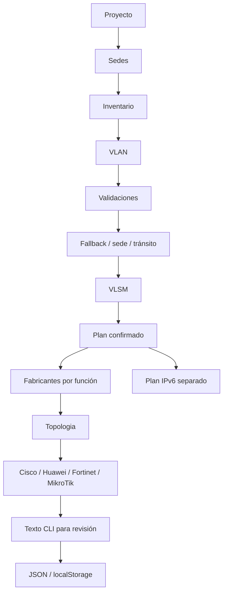

# Documentación integral del código — WAN Architect

## Edición final de normalización

Base main `3e3ed118544be32e32aa7cd6f74ca61b3eb74665` tras el squash documental del PR #12. Rama `refactor/normalizacion-final-wan-architect`. **222 funciones declaradas JavaScript y 19 funciones Python documentadas: 241 contratos**. No se cuentan como funciones nuevas ni como pruebas adicionales. Los callbacks anónimos siguen dentro de sus operaciones propietarias; el índice cuenta declaraciones nombradas, incluido `solve` anidado.

La normalización modifica presentación del código y comentarios, no algoritmos, contratos, CLI, catálogo ni interfaz. Se conserva el HTML autónomo, CSS en el mismo archivo y JavaScript sin framework. El servicio Python sigue siendo opcional. Se conservan nombres, IDs, eventos, atributos, valores CSS, orden de reglas, media queries y controles; no se renombra una clave que utilicen UI/JSON/tests.

Prettier 3.6.2 se usa como herramienta temporal de edición, fuera del repositorio y sin añadir dependencia de ejecución. `htmlWhitespaceSensitivity: strict` y preservación de claves entrecomilladas evitan cambios de texto/contrato. El bloque `wanCatalogData` generado se restaura exactamente, sin editar sus fichas. `python tools/build_catalogo.py --check` comprueba su sincronización. JavaScript se compara por AST Acorn, CSS por forma canónica preservando reglas/valores y HTML por estructura canónica con scripts/estilos comparados aparte. En Python solo cambian docstrings: AST ejecutable idéntico al ignorarlos. Los números de línea no son contratos.

### Cómo leer los contratos

Cada función JavaScript incluye propósito, entradas reales, rutas de retorno explícitas, escrituras directas de estado (incluidas ramas/callbacks), validaciones relacionadas, dependencias locales y tratamiento de errores. Estos datos describen operaciones presentes en el cuerpo, no un análisis formal de todos los caminos: una llamada delegada puede añadir efectos o errores. `sin escritura directa` no significa pureza si se escribe DOM o se llama a otras funciones. Las funciones Python tienen docstrings específicos de parámetros, retorno, efectos, dependencias y errores públicos; credenciales siguen siendo efímeras.

## Arquitectura y mapa de módulos actuales

| Índice | Vista | Responsabilidad y dependencias |
| --- | --- | --- |
| 00 | Resumen | `dashboard`, datos/estados reales, exportación de resumen |
| 01 | Datos del proyecto | `projectView`, `saveProject`, `saveSite`, fichas y confirmaciones |
| 02 | Estimación | `estimateView`, `counts`, `proposal`, inventario confirmado |
| 03 | VLAN y VLSM | `proposeVlans`, `readVlans`, `allocate`, `confirmVlans`, plan efectivo |
| 04 | Subnetting | `calculate`, `addressCalculation`, IPv4/IPv6 independiente |
| 05 | Topología | `buildTopology`, `svgTopology`, nodos/enlaces, modelos y puertos |
| 06–09 | Cisco/Huawei/Fortinet/MikroTik | Generadores separados, tabla física y descargas |
| 10 | Comparación | `compareFourEntries`, extractos nativos y equivalencia IOS/VRP explícita |
| 11 | Ciberdefensa | `securityWarnings`, `securityView`, validaciones y políticas |
| 12 | Planificación IPv6 | `allocateIPv6`, `confirmIPv6`, plan independiente |
| 13 | Consola SSH | Simulación local; conexión real opcional y explícita |

Flujo: proyecto → sedes → inventario → VLAN/intenciones → plan IPv4/IPv6 → aprobación efectiva → fabricantes/roles → grafo/modelos/puertos → cuatro adaptadores → CLI revisable → JSON/localStorage. `go` y `render` aplican barreras de módulos dependientes; calculadora y SSH manual no se subordinan a VLSM. Cambiar idioma reconstruye presentación conservando borradores/estado; una conexión real se cierra para no dejar terminales ocultos.

## Algoritmos, explicados paso a paso

### 1. Subnetting IPv4

1. `subnet` separa dirección/prefijo y valida ambos con `ipNum` y `num`.
2. Calcula tamaño como 2 elevado a 32−prefijo; red mediante división entera alineada y último valor como red+tamaño−1.
3. Obtiene máscara, broadcast y extremos utilizables; trata /31 y /32 según reglas del cálculo existente.
4. `addressCalculation` selecciona la familia; `calculate` solo muestra resultado válido. Una entrada errónea conserva el cálculo previo.

### 2. VLSM y pools independientes

1. `allocationPools` valida fallback, bloques propios de sede y tránsito sin obligar a contener sedes dentro del fallback.
2. `manualVlanNetworks` valida alineación, capacidad, pertenencia al pool efectivo, gateway y solapamientos; reserva manuales antes de las automáticas.
3. `allocate` conserva filas previas que siguen válidas en su pool y cuya demanda/intención no cambió.
4. Ordena solicitudes por tamaño y clave estable. `findIPv4Space` busca huecos alineados, excluyendo reservas, asignaciones y bloques de otras sedes.
5. Calcula required/size, máscara, rango, broadcast y gateway/reservas. /30 de tránsito respeta el pool dedicado o fallback libre.
6. Si no hay espacio contiguo suficiente, falla con sede/VLAN y demanda: no amplía ni mueve redes manuales. El plan candidato se devuelve completo antes de adoptarlo.

### 3. Planificación IPv6

1. `ipv6Number` interpreta grupos/comprensión y produce BigInt solo en memoria; `ipv6String` representa canónicamente.
2. `ipv6Blocks` valida global ULA y bloques /56 manuales, contención y solapamientos.
3. `allocateIPv6` reserva manuales y asigna /56 por sede ordenada por ID.
4. Dentro de cada sede ordena VLAN por clave, asigna /64 y comprueba capacidad.
5. `ipv6Row` reserva dirección completa +1 como router, o +1 virtual y +2/+3 físicas con redundancia. No configura protocolos ni tránsitos IPv6.
6. Persistencia usa cadenas: nunca se serializa BigInt; IPv4 y CLI permanecen separados.

### 4. VLAN, inventario y confirmaciones

`proposeVlans` deriva segmentos de servicios e inventario sin tratar una propuesta como confirmación. `readVlans` valida todas las filas visibles; `deleteVlan` lo reutiliza antes de retirar la seleccionada. Cancelar o un error conserva lo escrito. `confirmVlans` lee intención candidata, llama al asignador y solo después sustituye datos e invalida derivados. `confirmedPlan` comprueba coherencia efectiva; una bandera aislada no basta. Inventario y fichas sin cambios reales conservan diseños; `invalidateSite` delimita dependencias locales y vecinos WAN afectados.

### 5. Creación y edición de topología

`buildTopology` exige plan confirmado, valida perfiles de fabricante y estima límites antes de construir. Genera equipos por rol y enlaza redes efectivas; conserva IDs automáticos, overrides, modelos y equipos manuales. `siteCode` deriva nombres únicos. `arrangeTopology` cambia coordenadas, no redes/IDs. `svgTopology`, `deviceIcon` y `bindDrag` separan dibujo de datos. `saveNode`/`saveLink` validan candidatos antes de adoptarlos. Imagen cargada es referencia manual, sin OCR; exportar SVG no conecta equipos.

### 6. Asignación automática de interfaces

1. `modelsFor` filtra por marca/rol y `validateNodeModel` confirma IDs conocidos.
2. `assignCatalogInterfaces` copia enlaces y construye conjuntos de puertos usados por equipo.
3. Comprueba capacidad y modos; conserva asociaciones previas válidas de su enlace.
4. Ordena enlaces por cantidad de alternativas y clave. `catalogPurpose` prioriza WAN/LAN/uplink/access; `catalogPair` exige medio/velocidad común.
5. `solve` retrocede sobre clases equivalentes y mantiene un límite explícito. Si no existe asignación, falla sin inventar puertos ni adoptar estado parcial.
6. `validateCatalogBindings` comprueba importaciones sin reasignar silenciosamente. `requireCatalogReady` verifica funciones activas contra capacidades conservadoras.

### 7. Validación de fabricante y modelo

`validateVendorProfile` verifica elecciones por función; `validateNodeVendor` evita convertir roles para forzar una marca. Dos cores redundantes no se tratan como una redundancia interoperable entre HSRP/VRRP. `validateNodeModel` relaciona rol/marca/ficha exacta; `setNodeModel` adopta solo después de comprobar todo el grafo afectado. AP continúa como dispositivo gestionable sin adaptador CLI genérico. Un modelo ausente mantiene Modo genérico con advertencia; uno desconocido se rechaza.

### 8. Cisco IOS/IOS XE

`generate` excluye AP y valida catálogo, marca y `assertReady`. Resuelve LAN, enlaces, rol y opciones comunes, y elige únicamente la rama Cisco. Emite hostname/seguridad, VLAN y puertos, SVI o enlaces enrutados, gateway/reservas y opciones de OSPF/DHCP/relay/rutas según rol. `trunkCommands` y `wildcard` suministran sintaxis propia. Los nombres efectivos vienen de enlaces/modelo; no se reemplazan por ejemplos universales.

### 9. Huawei VRP

La otra rama explícita de `generate` emite system-view/sysname, VLAN y puertos VRP, Vlanif y opciones pertinentes. El perfil Huawei LI del laboratorio es L2 y no hereda capacidades del adaptador L3 genérico. `requireCatalogReady` bloquea funciones no respaldadas. Una equivalencia de Comparación no reclasifica hardware ni certifica modelos. La CLI no se traduce al cambiar ES/EN.

### 10. Fortinet FortiOS

`generateFortinet` acepta Firewall nativo, confirma plan/topología y valida nombre/opciones. `fortinetInterfaces` deriva direcciones del plan y enlaces; `fortinetPath`/`fortinetRoute` resuelven caminos reales. Se construyen interfaces, objetos y funciones pertinentes, administración restringida y políticas sin permisos implícitos. No se inventan NAT/Internet/VDOM, HA o LACP. El texto no es un respaldo idempotente ni se aplica automáticamente.

### 11. MikroTik RouterOS

`generateMikroTik` exige Router nativo y plan coherente. `mikrotikInterfaces` distingue puertos, LAN y enlaces enrutados; `mikrotikRoute` determina siguientes saltos y `mikrotikDhcpRanges` excluye reservas. Emite identidad, puertos, bridge/VLAN cuando procede, IPv4, rutas, OSPF v7, DHCP/relay y endurecimiento. Revisa objetos/puertos previos; forward no se vuelve permisivo sin intención. No asume VRF/CAPsMAN/VRRP/LACP/IPv6.

### 12. Comparación de configuraciones

`compareFourEntries` extrae propuestas reales compatibles para interfaces, VLAN/LAN, OSPF, DHCP/relay y administración; no crea equipos ficticios ni cambia fabricantes/opciones. `compareFourView` muestra límites o ausencia de un rol/función. `generateCompare` conserva una equivalencia lógica IOS/VRP explícita, separada de la propuesta nativa.

### 13. Ciberdefensa y errores

Validadores numéricos, textos, hostnames, interfaces, CIDR y listas cerradas limitan entradas en su frontera. `esc` (función flecha existente) presenta texto seguro; no evalúa el JSON. `fail` aborta y `safe` presenta errores de acciones. `topologyIssues` distingue incoherencias bloqueantes de avisos; `securityWarnings` no es una auditoría exhaustiva. Marcadores técnicos no son credenciales. Las propuestas requieren revisión de plataforma y autorización externa.

### 14. Guardado e importación JSON

`exportJSON` serializa state/imageData v4, no sesiones SSH. `saveLocal` usa clave v4; `loadLocal` prioriza v4 y, cuando no existe, busca v3/v2 sin sobrescribirlas automáticamente. `validateImport` reconstruye estructura conocida, ejecuta `migrateV2`/`migrateV3` y verifica tipos, límites, IDs, redes, modelos, puertos y CLI válida. `applyImport` recibe solo el candidato completo validado: no llama a asignadores durante carga. Un error no sustituye el proyecto.

### 15. Simulación SSH

`sshCommands` define la lista cerrada por marca. `sshRunSimulation` normaliza solo espacios/capitalización de consultas de lectura y devuelve datos/propuestas del proyecto. No hay conexión ni running-config real, rutas aprendidas o ping. Limpiar/reiniciar cambia únicamente el historial educativo; el manual integrado es local y bilingüe.

### 16. Servicio SSH real opcional

El HTML solicita conexión explícita con `sshConnect`, carga xterm local y descarta recursos/credenciales con `sshDispose`. En Python, `create_app` registra boundary y rutas fijas; bootstrap autoriza navegador local con cookie/token efímeros. `destination` aplica allowlist y DNS fijado; `trust_host` exige huella explícita y no reemplaza claves modificadas. `connect_for_socket` cancela negociación si cierra WS. `websocket` valida autenticación/mensajes, crea PTY y transporta entrada manual; `output` aplica ACK y backpressure. finally/shutdown cierran tareas, SSH, WS y estado efímero. Nada envía automáticamente la configuración generada.

### 17. Laboratorio automático

`demo` pide autorización, captura proyecto/borradores y ejecuta los mismos validadores del flujo real. Inicializa sedes privadas independientes, confirma inventario/VLAN/fabricantes, construye grafo y elige modelos con capacidad. Asigna puertos y genera propuestas nativas; si falla restaura la instantánea completa. Resultado del escenario: 21 redes, 42 nodos, 48 enlaces y 16 CLI. No se marcan aprobaciones ficticias ni se sobrescribe localStorage sin acción.

### 18. Internacionalización ES/EN

`I18N`, `t` y `localizeMessage` resuelven presentación/mensajes con parámetros. `setLanguage` captura y restaura borradores, foco y scroll; conserva valores internos, planes y CLI. La preferencia local no es parte de state. Traducir no confirma formularios, no consulta IA ni modifica nombres de usuario/JSON. El catálogo generado y los bloques CLI no se formatean como contenido traducible.

## Contratos de estado y mantenimiento

- Proyecto v4: datos, base IPv4 fallback, transitBase opcional, ipv6Base opcional y opciones. Sedes: IDs estables, inventario, servicios, redundancia, bloques propios y perfil de fabricantes. VLAN: clave, sede, ID, rol, hosts, DHCP, CIDR manual opcional.
- `plan`: resultado IPv4 efectivo y sus relaciones; `ipv6Plan`: resultado independiente por clave VLAN con cadenas IPv6. `nodes`: roles/marcas/modelId opcional y coordenadas. `links`: extremos, tipo/red y nombres efectivos por marca. `configs`: textos derivados/revisión/opciones.
- Importaciones v2/v3 migran sin asignar redes nuevas. No se promete que la aplicación antigua lea extensiones v4. LocalStorage/JSON no están cifrados.
- Ampliar catálogo exige fuentes oficiales, ficha independiente, sincronización y pruebas; no editar el bloque generado manualmente. No usar un nombre de marca nuevo como rama genérica.
- Para cambios funcionales: capturar línea base, modificar un módulo acotado y sus validadores, comprobar atomicidad/derivados/persistencia, ejecutar suites y revisar diff/secretos. No actualizar fixtures para ocultar regresiones.
- Los contratos de comentarios se revisan junto al código si cambia una firma, retorno, validación o efecto. El índice siguiente evita depender de números de línea. Los anexos previos se conservan como contexto histórico identificado.

## Índice completo de funciones JavaScript documentadas

| Función | Propósito | Entradas | Dependencias directas de aplicación |
| --- | --- | --- | --- |
| `accessPoint()` | Reconoce AP para conservarlos en diseño y excluir su CLI genérica. | `n` |  |
| `addressCalculation()` | Selecciona el cálculo IPv4 o IPv6 según la entrada validada. | `value` | `ipv6Subnet`, `subnet` |
| `addressResult()` | Renderiza el resultado de la familia de direcciones sin mezclar sus modelos. | `r` | `subnetResult`, `t` |
| `addVlan()` | Añade una fila de segmentación manteniendo claves estables y valores pendientes válidos. | `sin parámetros` | `invalidate`, `render`, `safe`, `siteName`, `t`, `toast` |
| `allocate()` | Resuelve un plan IPv4 candidato completo sin adoptarlo antes de validar capacidad y conflictos. | `vlans, base, growth, transits, project = state.project` | `allocationPools`, `fail`, `findIPv4Space`, `ipStr`, `isHost`, `manualVlanNetworks`, `siteName`, `subnet`, `t` |
| `allocateIPv6()` | Asigna bloques de sede y redes VLAN de forma determinista en un plan IPv6 separado. | `project, sites, vlans` | `fail`, `ipv6Blocks`, `ipv6Row`, `ipv6String`, `ipv6Subnet`, `t` |
| `allocationPools()` | Construye pools y reservas independientes para sedes, fallback global y tránsito. | `base, project = state.project, siteList = state.sites` | `fail`, `privateIPv4Block`, `subnet`, `t`, `validateSiteBlocks` |
| `applyImport()` | Adopta un candidato ya validado y reinicia solo presentación/sesiones correspondientes. | `data` | `render` |
| `arrangeTopology()` | Reorganiza coordenadas jerárquicas sin borrar nodos, enlaces ni identificadores. | `refresh=true` | `render` |
| `assertReady()` | Comprueba plan, topología, roles e interfaces antes de generar CLI. | `n` | `configurable`, `connected`, `endpoint`, `fail`, `hostname`, `isHost`, `requireConfirmedPlan`, `switching`, `t`, `topologyIssues` |
| `assignCatalogInterfaces()` | Asigna puertos en una copia del grafo con reservas, capacidad y búsqueda determinista. | `data` | `catalogPair`, `catalogPurpose`, `fail`, `solve`, `t`, `validateNodeModel` |
| `availableIPs()` | Obtiene direcciones utilizables del plan respetando reservas y dispositivos existentes. | `r, n, excluded = []` | `fail`, `ipStr`, `t` |
| `badge()` | Representa visualmente un estado sin cambiar su valor interno. | `ok, yes = "Cumplido", no = "Pendiente"` | `t` |
| `bindDrag()` | Conecta arrastre del diagrama con las coordenadas de los nodos. | `sin parámetros` | `editNode`, `node`, `render` |
| `bool()` | Exige un booleano real para evitar coerciones silenciosas en importación. | `v` | `fail`, `t` |
| `buildTopology()` | Deriva el grafo desde redes y roles confirmados conservando IDs y equipos manuales. | `sin parámetros` | `arrangeTopology`, `assignCatalogInterfaces`, `availableIPs`, `counts`, `endpoint`, `fail`, `hostname`, `proposal`, `refreshPhysicalProfiles`, `render`, `requireConfirmedPlan`, `row`, `safe`, `siteCode`, `t`, `toast`, `topologyIssues`, `validateCatalogBindings`, `vendorProfile` |
| `calculate()` | Valida la entrada y muestra el cálculo IPv4/IPv6 conservando el resultado previo ante error. | `sin parámetros` | `addressCalculation`, `addressResult`, `safe` |
| `captureDraft()` | Guarda valores visibles de una vista antes de cambiar su presentación. | `sin parámetros` |  |
| `catalogControls()` | Muestra selección de modelos exclusivamente en la vista de Topología. | `vendor=''` | `accessPoint`, `catalogInventory`, `configNodes`, `configurable`, `fortinetNode`, `mikrotikNode`, `modelOptions`, `modelsFor`, `t` |
| `catalogInventory()` | Presenta puertos, límites y fuentes del modelo seleccionado. | `n` | `connected`, `endpoint`, `t` |
| `catalogPair()` | Comprueba medio y velocidad común entre ambos extremos sin inventar ópticas. | `a, b` |  |
| `catalogPurpose()` | Deriva prioridad WAN/LAN/uplink/access para asignar puertos compatibles. | `l, n, data` |  |
| `catalogSavedSummary()` | Renderiza inventario físico de siete columnas desde nodos y enlaces reales. | `vendor` | `configNodes`, `connected`, `endpoint`, `t` |
| `changeFortinetOpts()` | Valida y guarda opciones Fortinet retirando textos que ya no correspondan. | `sin parámetros` | `fail`, `ipNum`, `safe`, `t`, `text` |
| `changeOpts()` | Valida opciones comunes y retira propuestas obsoletas cuando cambian realmente. | `sin parámetros` | `fail`, `ipNum`, `ipStr`, `render`, `safe`, `t` |
| `closeModal()` | Cierra el diálogo sin confirmar por sí mismo cambios pendientes. | `sin parámetros` |  |
| `commandName()` | Restringe identificadores que se interpolan en comandos o nombres internos. | `v` |  |
| `compareFourEntries()` | Obtiene extractos reales de cuatro marcas por función sin cambiar el proyecto. | `key` | `configNodes`, `enumVal`, `fortinetNode`, `generate`, `mikrotikNode`, `routed`, `switching`, `t` |
| `compareFourView()` | Presenta diferencias y límites de los extractos de cuatro fabricantes. | `sin parámetros` | `compareFourEntries`, `t` |
| `compareView()` | Ofrece comparación nativa y equivalencia lógica adicional IOS/VRP diferenciadas. | `sin parámetros` | `compareFourView`, `configBlock`, `configControls`, `node`, `t`, `title` |
| `configBlock()` | Presenta el texto guardado de un equipo y sus acciones de copia/descarga. | `n, v` | `t` |
| `configControls()` | Presenta opciones reales de generación y dependencias DHCP/relay/ruta. | `sin parámetros` | `field`, `t` |
| `configNodes()` | Filtra equipos nativos configurables de una marca y excluye AP. | `vendor` | `configurable` |
| `configurable()` | Limita los roles admitidos por el adaptador genérico de router/switch. | `n` | `accessPoint`, `fortinetNode`, `mikrotikNode`, `routed`, `switching` |
| `configView()` | Muestra controles compartidos, inventario físico y propuestas de la marca solicitada. | `vendor` | `catalogSavedSummary`, `configBlock`, `configControls`, `configNodes`, `siteName`, `t`, `title` |
| `confirmedPlan()` | Valida la aprobación efectiva: una bandera aislada no demuestra un VLSM coherente. | `sin parámetros` | `allocationPools`, `initialTransits`, `isHost`, `pendingVlans`, `subnet` |
| `confirmIPv6()` | Adopta un plan IPv6 válido sin cambiar el plan IPv4 ni la CLI de fabricantes. | `sin parámetros` | `allocateIPv6`, `fail`, `ipv6Subnet`, `render`, `safe`, `t`, `toast` |
| `confirmVlans()` | Confirma VLAN y sustituye plan/derivados solo después de una asignación completa válida. | `sin parámetros` | `allocate`, `fail`, `initialTransits`, `ipNum`, `ipStr`, `num`, `projectValid`, `readVlans`, `refreshPhysicalProfiles`, `render`, `safe`, `t`, `toast`, `updateVlanStatus` |
| `connected()` | Obtiene los enlaces incidentes de un dispositivo para interfaces y rutas. | `n` |  |
| `copyConfig()` | Copia CLI exacta al portapapeles y ofrece alternativa cuando el navegador lo bloquea. | `id, v` | `modal`, `t`, `toast` |
| `coreAddress()` | Resuelve la dirección física de core sin duplicar el gateway virtual. | `n, r` | `availableIPs`, `fail`, `t` |
| `counts()` | Resuelve inventario personalizado o estimado sin sumar terminales dos veces. | `s` | `estimated` |
| `dashboard()` | Resume datos, estimaciones y estados reales de aprobación del proyecto. | `sin parámetros` | `badge`, `counts`, `proposal`, `securityWarnings`, `t`, `title`, `topologyIssues` |
| `deleteLink()` | Retira el enlace seleccionado y las configuraciones que dependían de él. | `id` | `invalidate`, `render`, `t` |
| `deleteNode()` | Elimina un equipo autorizado por el usuario y sus referencias relacionadas. | `id` | `invalidate`, `render`, `t` |
| `deleteVlan()` | Lee primero las ediciones visibles válidas y elimina únicamente la fila confirmada. | `i` | `invalidate`, `readVlans`, `render`, `safe`, `t` |
| `demo()` | Construye el laboratorio completo mediante validaciones reales y rollback ante error. | `sin parámetros` | `assignCatalogInterfaces`, `buildTopology`, `captureDraft`, `configNodes`, `configurable`, `confirmVlans`, `confirmedPlan`, `connected`, `fail`, `fortinetNode`, `fresh`, `generateAll`, `mikrotikNode`, `modelsFor`, `proposeVlans`, `render`, `safe`, `saveCounts`, `saveProject`, `saveSite`, `saveVendorProfiles`, `siteDefault`, `t`, `toast`, `validateCatalogBindings`, `validateImport`, `validateNodeModel` |
| `dependentPage()` | Clasifica qué vistas requieren direccionamiento confirmado sin bloquear las independientes. | `index` |  |
| `deviceIcon()` | Construye iconografía SVG local y original según la función del dispositivo. | `type` |  |
| `download()` | Crea una descarga local de contenido y libera el recurso temporal del navegador. | `name, content, mime` |  |
| `downloadAll()` | Descarga las propuestas disponibles de una marca validando que existan. | `v` | `download`, `t`, `toast` |
| `downloadConfig()` | Descarga la propuesta guardada de un equipo sin ejecutarla. | `id, v` | `download`, `node`, `t`, `toast` |
| `downloadPlan()` | Exporta las filas del plan efectivo en formato tabular sin recalcular redes. | `sin parámetros` | `download`, `siteName`, `t` |
| `downloadReport()` | Produce un resumen HTML local del diseño actual y sus límites. | `sin parámetros` | `dashboard`, `download`, `localizeMessage`, `planTable`, `securityWarnings`, `svgTopology`, `t` |
| `downloadSVG()` | Exporta la topología real como archivo SVG sin configurar equipos. | `sin parámetros` | `download`, `svgTopology`, `t`, `toast` |
| `editCounts()` | Abre la edición del inventario sin sustituir sus cantidades confirmadas. | `i` | `render` |
| `editGateway()` | Valida un gateway explícito y retira derivados que dependerían de una dirección obsoleta. | `key` | `fail`, `ipNum`, `ipStr`, `isHost`, `render`, `safe`, `t`, `toast` |
| `editLink()` | Abre la edición de un enlace real y sus interfaces de cada extremo. | `id = ""` | `field`, `lockCatalogLinkFields`, `modal`, `optsHTML`, `siteName`, `t`, `toast` |
| `editNode()` | Abre el editor de dispositivo y la selección filtrada de fabricante/modelo. | `id = ""` | `accessPoint`, `catalogInventory`, `field`, `modal`, `modelOptions`, `node`, `optsHTML`, `row`, `siteName`, `t` |
| `editProject()` | Habilita edición del proyecto sin invalidar el diseño por abrir el formulario. | `sin parámetros` | `render` |
| `editSite()` | Abre la ficha de una sede para modificarla conservando su instantánea previa. | `sin parámetros` | `render`, `siteFormSnapshot` |
| `editVendorProfiles()` | Abre la selección de marcas sin cambiar redes ni invalidar por mera navegación. | `sin parámetros` | `render` |
| `endpoint()` | Deriva dirección e interfaz de un extremo de enlace para su adaptador. | `l, n, vendor` | `node`, `row` |
| `enumVal()` | Restringe un valor importado a la lista de opciones admitidas. | `v, arr, label` | `fail`, `t` |
| `estimated()` | Obtiene las cantidades estimadas de terminales según los servicios de la sede. | `s` |  |
| `estimateView()` | Muestra inventario editable o confirmado y dimensionamiento preliminar. | `sin parámetros` | `counts`, `field`, `proposal`, `t`, `title` |
| `excludeAccessPoint()` | Bloquea explícitamente CLI genérica de AP conservando su representación de red. | `n` | `accessPoint`, `fail`, `t` |
| `exportJSON()` | Serializa el proyecto v4 y su imagen sin credenciales de sesión SSH. | `sin parámetros` | `download`, `t`, `toast` |
| `fail()` | Interrumpe la transacción con un error de validación que la interfaz puede presentar. | `msg` |  |
| `field()` | Renderiza un campo con su etiqueta y valor de interfaz. | `label, id, value, type = "text", extra = ""` | `t` |
| `findIPv4Space()` | Busca un hueco CIDR alineado: direcciones libres totales no garantizan continuidad. | `pool, size, blocked` |  |
| `fortinetControls()` | Presenta opciones específicas y límites de laboratorio FortiOS. | `sin parámetros` | `field`, `t` |
| `fortinetInterfaceName()` | Valida el nombre de puerto que se utilizará en la propuesta Fortinet. | `value, optional = false` | `fail`, `t` |
| `fortinetInterfaces()` | Deriva interfaces físicas/VLAN y direcciones FortiOS del plan y enlaces. | `n` | `connected`, `endpoint`, `fail`, `fortinetInterfaceName`, `fortinetNode`, `isHost`, `t` |
| `fortinetNode()` | Determina si el rol del equipo admite el adaptador FortiOS. | `n` |  |
| `fortinetPath()` | Busca un camino real de topología para resolver el siguiente salto. | `n, target` | `connected`, `endpoint`, `fortinetInterfaceName`, `routed` |
| `fortinetRoute()` | Obtiene una ruta FortiOS compatible con el grafo y direccionamiento del proyecto. | `n, r` | `connected`, `fortinetNode`, `fortinetPath` |
| `fortinetView()` | Presenta equipos Fortinet nativos, inventario y CLI correspondiente. | `sin parámetros` | `catalogSavedSummary`, `configBlock`, `configNodes`, `fortinetControls`, `t`, `title` |
| `fresh()` | Construye un proyecto v4 vacío con valores iniciales explícitos y sin datos de laboratorio. | `sin parámetros` | `siteDefault` |
| `generate()` | Produce propuesta Cisco o Huawei mediante ramas separadas a partir del mismo modelo. | `n, vendor` | `assertReady`, `availableIPs`, `commandName`, `connected`, `coreAddress`, `endpoint`, `excludeAccessPoint`, `fail`, `fortinetNode`, `generateFortinet`, `generateMikroTik`, `mikrotikNode`, `requireCatalogReady`, `routed`, `routerId`, `row`, `siteName`, `switching`, `t`, `trunkCommands`, `wildcard` |
| `generateAll()` | Genera propuestas de todos los equipos compatibles de una marca. | `vendor` | `changeOpts`, `configNodes`, `fail`, `generate`, `generateFortinetFromForm`, `generateMikroTikFromForm`, `render`, `safe`, `t`, `toast` |
| `generateCompare()` | Construye equivalencias explícitas sin reclasificar el fabricante físico del equipo. | `id` | `changeOpts`, `fail`, `generate`, `node`, `render`, `safe`, `t` |
| `generateFortinet()` | Genera una propuesta FortiOS separada sin inventar NAT ni políticas permisivas. | `n` | `connected`, `excludeAccessPoint`, `fail`, `fortinetInterfaces`, `fortinetNode`, `fortinetRoute`, `hostname`, `idVal`, `ipNum`, `ipStr`, `isHost`, `num`, `requireCatalogReady`, `requireConfirmedPlan`, `routerId`, `subnet`, `t`, `text`, `topologyIssues` |
| `generateFortinetFromForm()` | Conecta la selección de interfaz con generación Fortinet validada. | `all` | `changeFortinetOpts`, `configNodes`, `fail`, `generateFortinet`, `node`, `render`, `safe`, `t`, `toast` |
| `generateMikroTik()` | Genera propuesta RouterOS 7 con controles conservadores y sin NAT/Internet implícitos. | `n` | `connected`, `excludeAccessPoint`, `fail`, `hostname`, `ipNum`, `ipStr`, `isHost`, `mikrotikDhcpRanges`, `mikrotikInterfaces`, `mikrotikNode`, `mikrotikRoute`, `requireCatalogReady`, `requireConfirmedPlan`, `routerId`, `t`, `text`, `topologyIssues` |
| `generateMikroTikFromForm()` | Genera RouterOS desde la selección nativa y muestra errores de validación. | `all` | `configNodes`, `fail`, `generateMikroTik`, `ipNum`, `node`, `render`, `safe`, `t`, `text`, `toast` |
| `generateSelected()` | Genera únicamente el dispositivo seleccionado en el módulo de su marca. | `vendor` | `changeOpts`, `fail`, `generate`, `generateFortinetFromForm`, `generateMikroTikFromForm`, `node`, `render`, `safe`, `t`, `toast` |
| `go()` | Controla la navegación y evita el acceso programático a dependencias no confirmadas. | `i` | `captureDraft`, `dependentPage`, `render`, `safe` |
| `hostname()` | Rechaza nombres que podrían introducir sintaxis ajena en una configuración. | `v` | `fail`, `t`, `text` |
| `idVal()` | Valida identificadores estables que relacionan estructuras del proyecto. | `v` | `fail`, `t` |
| `importJSON()` | Lee un archivo limitado y solo aplica el resultado de una validación completa. | `input` | `applyImport`, `fail`, `t`, `toast`, `validateImport` |
| `initialTransits()` | Calcula las solicitudes de tránsito requeridas por roles y enlaces del diseño. | `sin parámetros` | `vendorProfile` |
| `inspectSubnet()` | Abre el cálculo de una red del plan sin modificar su asignación. | `i` | `go` |
| `interfaceName()` | Valida nomenclatura de interfaz antes de interpolarla en comandos. | `v` | `fail`, `t` |
| `invalidate()` | Invalida derivados que ya no corresponden a los datos primarios modificados. | `level = "project"` | `refreshPhysicalProfiles` |
| `invalidateSite()` | Retira dependencias de una sede y CLI de vecinos afectados, conservando otras sedes. | `siteId, dropVlans = false` | `refreshPhysicalProfiles` |
| `ipNum()` | Convierte IPv4 decimal en entero para operar sobre prefijos sin comparar cadenas. | `ip` | `fail`, `t` |
| `ipStr()` | Reconstruye una IPv4 decimal a partir del valor numérico calculado. | `n` |  |
| `ipType()` | Clasifica la dirección IPv4 para distinguir el espacio privado del público/especial. | `n` |  |
| `ipv6Block()` | Comprueba alineación y prefijo del bloque ULA que utilizará la planificación. | `value, label, min, max` | `fail`, `ipv6In`, `ipv6Number`, `ipv6Subnet`, `t` |
| `ipv6Blocks()` | Resuelve bloques de sede IPv6 y valida contención y ausencia de solapamiento. | `project, sites` | `fail`, `ipv6Block`, `ipv6Intent`, `t` |
| `ipv6In()` | Comprueba pertenencia a un prefijo IPv6 mediante su máscara de 128 bits. | `n, address, prefix` | `ipv6Number` |
| `ipv6Intent()` | Valida la intención opcional de prefijo IPv6 guardada como cadena. | `value, label` | `fail`, `t` |
| `ipv6Number()` | Interpreta IPv6 comprimido o completo mediante enteros de 128 bits en memoria. | `value` | `fail`, `t` |
| `ipv6Row()` | Construye una fila IPv6 por clave VLAN con router y reservas completas. | `v, site, pool, net` | `ipv6String` |
| `ipv6String()` | Produce representación canónica IPv6 sin serializar valores BigInt. | `n` | `fail`, `t` |
| `ipv6Subnet()` | Calcula límites y capacidad IPv6 sin inventar broadcast ni descontar dos direcciones. | `value` | `fail`, `ipv6Number`, `ipv6String`, `ipv6Type`, `t` |
| `ipv6Type()` | Clasifica IPv6 por espacio de direcciones sin atribuir conectividad al resultado. | `n` | `ipv6In` |
| `ipv6View()` | Presenta prefijos, estados y resultados IPv6 como módulo independiente. | `sin parámetros` | `field`, `siteName`, `t`, `title` |
| `isHost()` | Comprueba si una dirección pertenece al rango utilizable de la subred. | `ip, row` | `ipNum` |
| `loadImage()` | Carga una imagen limitada y validada como referencia manual, sin ejecutar OCR. | `input` | `fail`, `render`, `safe`, `t`, `toast` |
| `loadLocal()` | Prioriza v4 y permite migración no destructiva desde almacenamiento v3/v2. | `sin parámetros` | `applyImport`, `fail`, `safe`, `t`, `toast`, `validateImport` |
| `localizeMessage()` | Localiza mensajes con parámetros conservando los valores internos del proyecto. | `message` | `t` |
| `lockCatalogLinkFields()` | Protege campos de puertos gobernados por el catálogo frente a edición incompatible. | `sin parámetros` | `node` |
| `manualVlanNetworks()` | Valida todas las subredes manuales antes de reservar espacio para las automáticas. | `project, sites, vlans, nodes = [], pools = null` | `allocationPools`, `fail`, `isHost`, `privateIPv4Block`, `t` |
| `migrateV2()` | Añade intenciones v3 vacías conservando plan y datos IPv4 sin reasignar. | `src` |  |
| `migrateV3()` | Añade contrato IPv6 vacío v4 sin cambiar resultados IPv4 ya importados. | `src` |  |
| `mikrotikControls()` | Presenta opciones de RouterOS y límites de funciones admitidas. | `sin parámetros` | `field`, `t` |
| `mikrotikDhcpRanges()` | Obtiene rangos DHCP utilizables excluyendo direcciones reservadas del plan. | `r` | `fail`, `ipStr`, `t` |
| `mikrotikInterfaceName()` | Valida nombres de puertos RouterOS antes de construir comandos. | `value, optional = false` | `fail`, `t` |
| `mikrotikInterfaces()` | Deriva puertos, bridge/VLAN y direcciones RouterOS de enlaces reales. | `n` | `connected`, `endpoint`, `fail`, `fortinetNode`, `isHost`, `mikrotikInterfaceName`, `mikrotikNode`, `switching`, `t` |
| `mikrotikNode()` | Restringe el adaptador RouterOS al rol de router implementado. | `n` |  |
| `mikrotikRoute()` | Calcula rutas RouterOS usando caminos y siguientes saltos del proyecto. | `n, r` | `connected`, `endpoint`, `fortinetNode`, `mikrotikInterfaceName`, `mikrotikNode`, `node`, `routed`, `row` |
| `mikrotikView()` | Presenta equipos RouterOS nativos, inventario físico y texto generado. | `sin parámetros` | `catalogSavedSummary`, `configBlock`, `configNodes`, `mikrotikControls`, `t`, `title` |
| `modal()` | Presenta un diálogo reutilizable y accesible para acciones de edición. | `content` |  |
| `modelOptions()` | Construye la lista filtrada de modelos conservando sus IDs internos. | `vendor, type, id=''` | `modelsFor`, `t` |
| `modelsFor()` | Filtra fichas locales por fabricante y tipo de dispositivo compatibles. | `vendor, type` |  |
| `newProject()` | Solicita autorización antes de reemplazar el proyecto actual por uno vacío. | `sin parámetros` | `fresh`, `render`, `t` |
| `newULAPrefix()` | Propone un prefijo local ULA sin afirmar conectividad pública ni asignarlo automáticamente. | `sin parámetros` | `ipv6String` |
| `node()` | Resuelve un dispositivo por su identificador estable. | `id` |  |
| `num()` | Convierte y limita una cantidad numérica antes de usarla en dimensionamiento. | `v, min, max, label, integer = true` | `fail`, `t` |
| `optionalAddressIntent()` | Valida el tipo y longitud de una intención opcional guardada como cadena. | `value, label` | `fail`, `t` |
| `optsHTML()` | Construye opciones escapadas conservando los códigos internos de selección. | `arr, val` | `t` |
| `pendingVlans()` | Detecta pendientes de VLAN para proteger los módulos que dependen del plan. | `sin parámetros` | `vlanFormChanged` |
| `physicalBinding()` | Describe la asociación de extremo y enlace utilizada por perfiles físicos históricos. | `l, n` |  |
| `physicalName()` | Resuelve la interfaz efectiva del extremo y fabricante del enlace. | `value, vendor` | `fail`, `fortinetInterfaceName`, `mikrotikInterfaceName`, `t` |
| `planTable()` | Presenta redes efectivas, capacidad y gateways que usarán topología y adaptadores. | `sin parámetros` | `siteName`, `t` |
| `previewNodeModel()` | Actualiza la previsualización del editor sin confirmar el proyecto. | `id` | `accessPoint`, `catalogInventory`, `node` |
| `privateIPv4Block()` | Valida CIDR alineado completamente privado antes de usarlo como pool. | `value, label` | `fail`, `subnet`, `t` |
| `projectValid()` | Determina si los datos primarios del proyecto cumplen los requisitos mínimos. | `sin parámetros` | `fail`, `t`, `text` |
| `projectView()` | Presenta proyecto y fichas de sede con estados confirmados y edición explícita. | `sin parámetros` | `field`, `optsHTML`, `t`, `title` |
| `proposal()` | Dimensiona infraestructura sugerida a partir del inventario y parámetros vigentes. | `s` | `counts` |
| `proposeVlans()` | Deriva segmentos por servicio y sede sin reemplazar silenciosamente redes manuales. | `replaceAll = false` | `counts`, `go`, `invalidate`, `projectValid`, `proposal`, `safe`, `t`, `toast` |
| `readVlans()` | Reconstruye filas VLAN desde el formulario y valida relaciones antes de adoptarlas. | `sin parámetros` | `fail`, `manualVlanNetworks`, `num`, `t`, `text`, `vlanGatewayIntent` |
| `refreshPhysicalProfiles()` | Actualiza relaciones de perfiles históricos ante cambios de enlaces compatibles. | `sin parámetros` | `connected`, `physicalBinding` |
| `removeSite()` | Elimina una sede confirmada por el usuario e invalida sus relaciones dependientes. | `sin parámetros` | `invalidate`, `render`, `t`, `toast` |
| `render()` | Reconstruye la vista activa y sincroniza navegación, progreso y eventos asociados. | `sin parámetros` | `bindDrag`, `captureDraft`, `configView`, `confirmedPlan`, `dependentPage`, `pendingVlans`, `restoreDraft`, `siteFormSnapshot`, `sshDispose`, `t`, `toast`, `updateVlanStatus`, `vlanFormChanged` |
| `requireCatalogReady()` | Bloquea funciones activas no respaldadas por la ficha del modelo. | `n, vendor` | `connected`, `fail`, `routed`, `switching`, `t`, `validateCatalogBindings`, `validateNodeModel` |
| `requireConfirmedPlan()` | Detiene una acción dependiente cuando el plan no está realmente confirmado. | `sin parámetros` | `confirmedPlan`, `fail`, `t` |
| `resetCounts()` | Restaura la estimación tras confirmar el reemplazo de cantidades personalizadas. | `i` | `estimated`, `invalidateSite`, `render`, `t` |
| `resizeSites()` | Ajusta la cantidad de sedes mediante una acción explícita de usuario. | `sin parámetros` | `captureDraft`, `invalidate`, `num`, `render`, `safe`, `siteDefault`, `t`, `toast` |
| `restoreDraft()` | Restaura el borrador visible sin confundirlo con datos ya confirmados. | `sin parámetros` |  |
| `routed()` | Identifica el rol enrutado que requiere direcciones en extremos. | `n` | `fortinetNode` |
| `routerId()` | Obtiene el identificador de enrutamiento propuesto para el dispositivo. | `n` |  |
| `row()` | Busca una fila del plan por clave, evitando relacionar redes por posición visual. | `key` |  |
| `safe()` | Canaliza errores de acciones de interfaz hacia un aviso sin ocultar la validación. | `fn` | `t`, `toast` |
| `saveCounts()` | Confirma cantidades válidas de inventario y reconoce cuándo no hubo cambios reales. | `i` | `counts`, `fail`, `invalidateSite`, `num`, `render`, `safe`, `t`, `toast` |
| `saveLink()` | Confirma extremos, puertos y red de enlace sin adoptar inconsistencias parciales. | `id` | `assignCatalogInterfaces`, `closeModal`, `fail`, `fortinetInterfaceName`, `fortinetNode`, `interfaceName`, `invalidate`, `ipStr`, `mikrotikInterfaceName`, `mikrotikNode`, `node`, `num`, `render`, `safe`, `subnet`, `t`, `validateCatalogBindings`, `validateLink` |
| `saveLocal()` | Guarda el proyecto en la clave v4 del origen actual sin cifrar datos. | `sin parámetros` | `safe`, `t`, `toast` |
| `saveNode()` | Valida un candidato de equipo y puertos antes de sustituir datos y CLI dependientes. | `id` | `assignCatalogInterfaces`, `availableIPs`, `closeModal`, `connected`, `enumVal`, `fail`, `fortinetInterfaceName`, `fortinetNode`, `hostname`, `interfaceName`, `invalidate`, `ipNum`, `ipStr`, `isHost`, `mikrotikInterfaceName`, `mikrotikNode`, `node`, `render`, `routed`, `row`, `safe`, `switching`, `t`, `validateCatalogBindings`, `validateNodeModel`, `validateNodeVendor` |
| `saveProject()` | Valida datos de proyecto y aplica solamente sus cambios efectivos. | `sin parámetros` | `enumVal`, `fail`, `invalidate`, `num`, `render`, `safe`, `t`, `text`, `toast` |
| `saveSite()` | Adopta una ficha válida de sede con invalidación selectiva y conservación por igualdad. | `sin parámetros` | `fail`, `invalidateSite`, `manualVlanNetworks`, `num`, `render`, `safe`, `t`, `text`, `toast`, `validateSiteBlocks` |
| `saveVendorProfiles()` | Confirma fabricantes y resuelve dependencias afectadas de manera transaccional. | `sin parámetros` | `allocate`, `assignCatalogInterfaces`, `fail`, `initialTransits`, `proposal`, `render`, `safe`, `t`, `toast`, `validateCatalogBindings`, `validateNodeModel`, `validateNodeVendor`, `validateVendorProfile` |
| `securityView()` | Muestra controles de ciberdefensa y políticas de uso responsable de IA. | `sin parámetros` | `localizeMessage`, `securityWarnings`, `t`, `title` |
| `securityWarnings()` | Identifica riesgos concretos sin presentar el resultado como auditoría exhaustiva. | `sin parámetros` | `t`, `topologyIssues` |
| `selectSite()` | Cambia la sede seleccionada preservando los borradores correspondientes. | `index` | `captureDraft`, `render` |
| `setLanguage()` | Cambia la presentación y restaura borradores sin confirmar ni alterar el proyecto. | `language` | `render`, `t`, `toast` |
| `setNodeModel()` | Aplica la selección de modelo solo después de validar todas las asignaciones afectadas. | `id, modelId` | `assignCatalogInterfaces`, `fail`, `invalidate`, `node`, `render`, `safe`, `t`, `toast`, `validateCatalogBindings`, `validateNodeModel` |
| `showSSHManual()` | Abre ayuda integrada bilingüe sin depender de Python ni internet. | `sin parámetros` | `modal`, `sshCommands`, `t` |
| `siteCode()` | Deriva un código de sede para nombres de equipos, desambiguando colisiones. | `site` |  |
| `siteDefault()` | Crea la estructura inicial de una sede para mantener un contrato uniforme. | `n` |  |
| `siteFormSnapshot()` | Obtiene los valores relevantes de la ficha para comparar cambios reales. | `sin parámetros` |  |
| `siteName()` | Resuelve el nombre legible de una sede desde su identificador estable. | `id` |  |
| `solve()` | Explora asignaciones de puertos compatibles con retroceso acotado y restauración de alternativas. | `index` | `catalogPair`, `fail`, `solve`, `t` |
| `sshAuthMethod()` | Alterna campos de autenticación de sesión sin persistir sus secretos. | `sin parámetros` |  |
| `sshChooseDevice()` | Actualiza la selección educativa o manual sin iniciar una conexión automáticamente. | `id` | `render` |
| `sshClearReal()` | Limpia la pantalla del terminal sin enviar comandos al equipo remoto. | `sin parámetros` |  |
| `sshClearSimulation()` | Limpia únicamente el historial educativo mostrado. | `sin parámetros` |  |
| `sshCommands()` | Entrega la lista cerrada de consultas simuladas admitidas por fabricante. | `n` |  |
| `sshConnect()` | Autoriza y autentica una conexión explícita al servicio SSH local permitido. | `sin parámetros` | `sshDispose`, `sshLoadTerminal`, `sshSetStatus`, `t`, `toast` |
| `sshConsoleView()` | Presenta simulador o conexión real diferenciados y con estados de sesión. | `sin parámetros` | `confirmedPlan`, `connected`, `endpoint`, `field`, `sshCommands`, `sshManagementAddress`, `sshSelected`, `t`, `title` |
| `sshDisconnect()` | Solicita cierre de la conexión real mediante una acción explícita. | `sin parámetros` | `sshDispose`, `sshSetStatus` |
| `sshDispose()` | Libera terminal, WebSocket y credenciales efímeras al cerrar la sesión. | `sin parámetros` |  |
| `sshLoadTerminal()` | Carga recursos xterm locales cuando se necesita la conexión real opcional. | `sin parámetros` | `t` |
| `sshManagementAddress()` | Propone solo una dirección de gestión explícita sin confundirla con WAN/gateway. | `n` | `row` |
| `sshResetSimulation()` | Reinicia el simulador tras la acción explícita sin alterar el diseño. | `sin parámetros` | `sshClearSimulation`, `t`, `toast` |
| `sshRunSimulation()` | Interpreta consultas de lectura del proyecto sin abrir red ni ejecutar CLI remota. | `sin parámetros` | `confirmedPlan`, `connected`, `coreAddress`, `endpoint`, `generate`, `sshCommands`, `sshSelected`, `t` |
| `sshSelected()` | Resuelve el equipo elegido para consulta o conexión explícita. | `sin parámetros` |  |
| `sshSetStatus()` | Actualiza estados de conexión sin confundir negociación con autenticación completada. | `code` | `t` |
| `sshTab()` | Cambia modalidad SSH cerrando sesiones reales que no deben quedar ocultas. | `mode` | `render` |
| `subnet()` | Calcula límites, máscara, broadcast y capacidad de una subred IPv4. | `value` | `fail`, `ipNum`, `ipStr`, `ipType`, `num`, `t` |
| `subnetResult()` | Muestra el resultado IPv4 calculado sin alterar su precisión matemática. | `r` | `t` |
| `subnetView()` | Presenta la calculadora independiente de las confirmaciones del diseño. | `sin parámetros` | `addressCalculation`, `addressResult`, `field`, `siteName`, `t`, `title` |
| `svgTopology()` | Renderiza sedes, dispositivos y enlaces del grafo sin depender de recursos externos. | `sin parámetros` | `connected`, `deviceIcon`, `endpoint`, `node`, `row`, `t` |
| `switching()` | Identifica funciones de conmutación antes de emitir sintaxis de switch. | `n` |  |
| `t()` | Resuelve el texto de interfaz en el idioma activo sin traducir datos ni comandos. | `key, values = []` |  |
| `text()` | Restringe longitud y contenido de texto que entrará al contrato del proyecto. | `v, label, max = 100` | `fail`, `t` |
| `title()` | Construye el encabezado común de una vista para mantener consistencia de presentación. | `n, desc` | `t` |
| `toast()` | Presenta un aviso temporal accesible y distingue errores de confirmaciones. | `msg, error = false` | `t` |
| `toggleIPv6()` | Cambia la disponibilidad visual de la planificación opcional. | `sin parámetros` | `newULAPrefix` |
| `topologyIssues()` | Inspecciona incoherencias del grafo y distingue bloqueos de advertencias. | `sin parámetros` | `availableIPs`, `connected`, `isHost`, `mikrotikInterfaces`, `mikrotikNode`, `row`, `siteName`, `validateLink` |
| `topologyView()` | Presenta diagrama, modelos, editores y tablas que describen el grafo real. | `sin parámetros` | `catalogControls`, `connected`, `endpoint`, `node`, `row`, `siteName`, `svgTopology`, `t`, `title`, `vendorProfilesView` |
| `trunkCommands()` | Emite sintaxis de enlace trunk propia del fabricante y VLAN permitidas. | `c, lan` |  |
| `unique()` | Rechaza claves repetidas que harían ambiguas las referencias del proyecto. | `values, label` | `fail`, `t` |
| `updateNodeModels()` | Sincroniza las opciones de modelo del editor con la selección de marca y rol. | `id=''` | `modelOptions`, `modelsFor`, `previewNodeModel` |
| `updateVlanStatus()` | Actualiza disponibilidad y estado visual de la confirmación ante cambios del formulario. | `sin parámetros` | `confirmedPlan`, `t` |
| `validateCatalogBindings()` | Valida puertos persistidos sin reasignarlos silenciosamente durante importación. | `data` | `catalogPair`, `fail`, `t`, `validateNodeModel` |
| `validateImport()` | Reconstruye contratos v2/v3/v4 conocidos y rechaza relaciones incoherentes atómicamente. | `data` | `addressCalculation`, `bool`, `configurable`, `enumVal`, `fail`, `fortinetInterfaceName`, `fortinetNode`, `fresh`, `generate`, `hostname`, `idVal`, `interfaceName`, `ipNum`, `ipStr`, `ipv6Intent`, `ipv6Subnet`, `isHost`, `manualVlanNetworks`, `migrateV2`, `migrateV3`, `mikrotikInterfaceName`, `mikrotikNode`, `num`, `optionalAddressIntent`, `subnet`, `t`, `text`, `topologyIssues`, `unique`, `validateCatalogBindings`, `validateIPv6Plan`, `validateLink`, `validateNodeModel`, `validateNodeVendor`, `validatePhysicalProfile`, `validateSiteBlocks`, `validateVendorProfile` |
| `validateIPv6Plan()` | Comprueba que un plan IPv6 importado concuerda con intenciones y relaciones. | `src, out` | `fail`, `ipv6Block`, `ipv6Blocks`, `ipv6Row`, `t` |
| `validateLink()` | Comprueba relaciones, direcciones y duplicados de un enlace candidato. | `l, others` | `fail`, `fortinetInterfaceName`, `fortinetNode`, `mikrotikInterfaceName`, `mikrotikNode`, `node`, `routed`, `row`, `switching`, `t` |
| `validateNodeModel()` | Comprueba que el modelo pertenece al catálogo y admite la marca y el rol. | `n` | `fail`, `modelsFor`, `t` |
| `validateNodeVendor()` | Rechaza asociaciones de rol y marca no soportadas por los adaptadores. | `n` | `fail`, `t` |
| `validatePhysicalProfile()` | Valida metadatos físicos históricos sin reintroducir el formulario obligatorio retirado. | `n, vendor, p` | `bool`, `connected`, `enumVal`, `fail`, `physicalBinding`, `physicalName`, `t`, `text` |
| `validateSiteBlocks()` | Comprueba bloques independientes de sede y tránsito sin exigir contención en fallback. | `project, sites` | `fail`, `privateIPv4Block`, `t` |
| `validateVendorProfile()` | Valida marcas y funciones compatibles sin convertir roles para forzar generación. | `value` | `enumVal`, `fail`, `t` |
| `vendorProfile()` | Obtiene la selección de fabricantes por función de una sede. | `site` |  |
| `vendorProfilesView()` | Presenta perfiles de fabricantes con edición y confirmación explícitas. | `sin parámetros` | `optsHTML`, `t`, `vendorProfile` |
| `vlanFormChanged()` | Detecta diferencias reales entre formulario VLAN y último estado confirmado. | `sin parámetros` |  |
| `vlanGatewayIntent()` | Distingue un gateway automático anterior de una elección manual que debe conservarse. | `v, previousPlan = state.plan` |  |
| `vlanView()` | Muestra intención de VLAN y plan efectivo distinguiendo edición de aprobación. | `sin parámetros` | `confirmedPlan`, `field`, `optsHTML`, `planTable`, `t`, `title` |
| `wildcard()` | Calcula la máscara inversa IPv4 que requieren determinados comandos. | `mask` | `ipNum`, `ipStr` |
| `zoomTopology()` | Ajusta la escala visual del diagrama sin cambiar la red modelada. | `factor` |  |

## Funciones del servicio Python documentadas

`integer`, `load_config`, `destination`, `public_error`, `connect_for_socket`, `opening`, `create_app`, `boundary`, `index`, `asset`, `bootstrap`, `websocket`, `output`, `shutdown`, `favicon`, `manual`, `interface_catalog`, `trust_host`, `main`. Incluye funciones anidadas de sesión/servicio. Sus docstrings no cambian transporte ni política; la comparación AST excluye únicamente documentación, no instrucciones.

## Evidencia de conservación y límites

Comparación anterior/posterior del laboratorio con IPv6 confirmado: estado, intenciones, planes, topología y cuatro CLI exactamente iguales; 56 pantallas (14 vistas × ES/EN × 1440/390) idénticas píxel por píxel. No se cambian colores, tamaños ni distribución. La revisión no certifica todos los datos/navegadores/hardware. Los reportes actuales y comandos de reproducción se enlazan en [pruebas de normalización](pruebas-normalizacion.md).

## Anexos técnicos anteriores conservados

El contenido siguiente procede de tareas anteriores; las referencias a su base y conteos corresponden a aquellas versiones. La edición final y su índice superior son la referencia de organización; no se vuelve a introducir el formulario físico retirado ni un recurso externo obligatorio para el catálogo.

# Documentación del código — revisión integral WAN Architect

## Laboratorio y tabla física: actualización del PR #11

- `demo()` reemplaza únicamente tras confirmación explícita. Captura proyecto, imagen, selección, estado de edición y copias de mapas/sets de borradores. Construye el ejemplo en una transacción síncrona; cualquier fallo restaura el contexto anterior y comunica el error. Nunca llama a `saveLocal()` ni modifica datos durante importación normal.
- Su helper local `step(action, valid)` ejecuta las acciones públicas de confirmación y comprueba tanto el error observable como su condición de éxito. Se recorren proyecto, fichas, inventario, VLAN/VLSM, fabricantes y generación de topología. No se asigna `approved=true` ni confirmaciones artificiales dentro del constructor.
- Los bloques de sedes y tránsito son entradas exclusivas del ejemplo. Se conserva el cálculo existente de capacidad, crecimiento, reservas y gateways. El servidor DNS se obtiene de un nodo Servidor con IP del plan y se confirma mediante `confirmVlans()` antes de emitir CLI.
- La selección filtra `modelsFor(vendor,type)`, número de puertos asignables y modos de todos los enlaces; ordena por menor inventario suficiente y clave estable. `assignCatalogInterfaces()`, `validateCatalogBindings()` y las guardas de los cuatro adaptadores comprueban los nombres y capacidades reales. Se rechaza un catálogo insuficiente, sin modificarlo ni inventar interfaces.
- `generateAll()` genera cada marca desde el estado común; `validateImport()` comprueba que ese estado completo podrá recuperarse sin redistribuir. No cambian las plantillas de generadores, `allocate()`, esquema v4 ni migraciones.
- `catalogSavedSummary(vendor)` ahora devuelve una tabla física de solo lectura: agrupa `configNodes(vendor)` con tbody por dispositivo; resuelve puertos/vecinos mediante `connected()` y `endpoint()`. La función se deriva de tipo de enlace, sedes y VLAN de Gestión; no confunde un nombre físico wan1 con Internet. Sin modelo muestra Modo genérico. Rowspans agrupan metadatos; CSS limita la transformación a encabezados y preserva exactamente el hostname de datos.
- La tabla usa el contenedor horizontal responsive existente y mantiene la CLI debajo, sin selectores repetidos. AP no entra en `configNodes()` ni recibe comandos genéricos; su enlace sí aparece como vecino del switch.

Datos del ejemplo y límites: [manual](manual.md). Prueba pública L01 de quince pasos y L02–L05: [pruebas](pruebas.md). La semilla histórica de regresión se guarda como fixture de pruebas, no como función alternativa escondida de la aplicación.

## Correcciones funcionales del PR #11: dependencias y contratos

Base `89a5a2a948c965129ca28f40cb57f5f303f587b2`; [flujo de usuario](manual.md). Se añaden dos booleanos opcionales v4, `project.confirmed` y `sites[].vendorsConfirmed`, validados estrictamente por `validateImport()` y conservados por JSON/localStorage; archivos antiguos sin ellos no se interpretan como confirmados. `projectEditing`/`vendorsEditing` son presentación temporal, reiniciada al importar/cargar/crear proyecto.

- `saveProject()` valida un candidato y bloquea campos solo tras éxito. Igualdad conserva estado/derivados; estructura/segmentación/WAN mantienen invalidación vigente. El nombre cambia cabeceras CLI y solo retira esos textos, sin borrar redes. `editProject()` no invalida nada. `resizeSites()` conserva identificación pendiente tras cambiar la cantidad; aplicar la misma cantidad no invalida.
- `saveVendorProfiles()` valida perfiles y copia el proyecto. Cambios de marca actualizan nodos automáticos sin override, validan su modelo y conservan plan/aprobación. Marcas incompatibles con un modelo fallan atómicamente. Nuevos roles físicos reservan /30 adicionales conservando filas anteriores; el candidato se adopta al final. Se retiran cachés de nodos/vecinos afectados sin cambiar la revisión global y obsoletar otras sedes. `editVendorProfiles()` solo abre campos.
- `tools/build_catalogo.py` ahora sincroniza JSON→JS y JSON→script embebido en `WAN_v4.html`. La carga es síncrona y precede a `interfaceCatalog`; no hay fetch ni archivo externo obligatorio. Los datos oficiales permanecen idénticos; `--check` comprueba ambas copias.
- `catalogControls()` queda en Topología; `catalogSavedSummary()` muestra únicamente inventario guardado en Configuración. La asignación y el importador conservan sus validadores nativos de modelo/enlaces; no se reintroduce un formulario físico obligatorio.
- `compareFourEntries()` filtra equipos reales por rol/función y usa adaptadores existentes sin guardar resultados ni cambiar marcas/opciones. `compareFourView()` muestra extractos por cuatro fabricantes, diferencias y bloqueos. `generateCompare()` conserva la equivalencia adicional IOS/VRP, claramente separada.
- `sshRunSimulation()` normaliza únicamente comandos de lectura simulados, selecciona una lista cerrada por marca y muestra CLI vigente o la genera en memoria sin cachearla. Interfaces virtuales de core se derivan del plan; no se inventa estado operativo. `showSSHManual()` muestra un diálogo local escapado/bilingüe. No se modifican funciones de conexión, credenciales, transporte ni controles SSH reales.

Pruebas y límites: [pruebas](pruebas.md), [catálogo](catalogo-modelos.md) y [manual SSH](manual-ssh.md). La navegación file:// puede ser bloqueada por política del entorno; no se elude ni se cuenta como superada.

## Cómo estudiar esta aplicación

La aplicación sigue siendo un solo archivo autónomo, `WAN_v4.html`. HTML define la estructura; CSS la presentación; JavaScript valida datos, calcula redes, renderiza vistas y genera propuestas de comandos. No hay backend obligatorio. El servicio SSH opcional permite únicamente la administración manual explícita; simulación y módulos tradicionales permanecen autónomos. El botón Generar produce texto para revisión humana: nunca configura equipos.

Base de esta revisión: `1956d1872363c88399f5e8240abb1d7a13bca340`. Lea primero las reglas de [AGENTS.md](../AGENTS.md), el [estado](estado-proyecto.md) y las [pruebas](pruebas.md). Las líneas cambian al documentar: busque el nombre de función, no un número de línea histórico.

## Catálogo de interfaces: extensión opcional v4 (14 de noviembre de 2026)

El contrato IPv4/IPv6 y sus migraciones no cambian. `nodes[].modelId` opcional identifica una ficha local; ausencia conserva modo genérico. Fuente de datos: `data/catalogo-interfaces.json`; `tools/build_catalogo.py` genera un script de datos estático para HTTP/file://. No se usa internet en tiempo de ejecución. La ruta fija del servidor SSH opcional sirve únicamente ese recurso; no añade directorios ni cambia autenticación/SSH.

- `modelsFor()` filtra fabricante y rol; `validateNodeModel()` rechaza modelos desconocidos/incompatibles y AP.
- `modelOptions()`, `catalogControls()` y `catalogInventory()` muestran selección e inventario escapado, restricciones y fuentes; `previewNodeModel()`/`updateNodeModels()` modifican solo el editor, sin mutar proyecto.
- `catalogPurpose()` deriva prioridad WAN/LAN/uplink/access desde el enlace. `catalogPair()` comprueba medio y velocidad común; el par genérico se considera solo cobre.
- `assignCatalogInterfaces(data)` recibe nodos/enlaces, crea una copia y devuelve enlaces asignados. Reserva asociaciones válidas anteriores, detecta capacidad y modos, ordena por restricciones/ID estable y retrocede por clases equivalentes, con límite de 30.000 pasos. No inventa puertos ni cambia planes.
- `validateCatalogBindings(data)` comprueba nombres incluidos/asignables, modos, duplicados y pareja; importa sin reasignar. `requireCatalogReady()` usa la matriz de capacidades para bloquear funciones activas no respaldadas antes de las plantillas CLI.
- `setNodeModel()` realiza validación/asignación completa antes de adoptar estado e invalidar configuraciones derivadas; mantiene redes, IDs y topología. `saveNode()` integra el mismo contrato con edición normal de fabricante; `buildTopology()` conserva `modelId` y puertos previos válidos al regenerar.
- `saveLink()` asigna antes de guardar. `lockCatalogLinkFields()` deja los nombres nativos del modelo como lectura, sin pedirlos al usuario; las referencias genéricas históricas conservan su edición existente.
- `endpoint()` sigue siendo la entrada común de nombres para los cuatro adaptadores, cuyas plantillas no se duplican. Perfiles archivados no sustituyen los nombres del catálogo cuando hay modelo explícito. Comparación advierte que una sintaxis alternativa usa puertos genéricos, sin atribuir un segundo hardware al mismo nodo.
- `validateImport()` valida `modelId` cerrado y enlaces antes de adoptar proyecto; exportación y localStorage lo conservan automáticamente con el resto de nodos. v2/v3/v4 sin ese campo siguen funcionando. No se almacena inventario duplicado en cada proyecto.

Las funciones nuevas y modificadas incluyen comentarios en español. Roles, variantes, fuentes y límites conservadores: [catálogo de modelos](catalogo-modelos.md). No se certifican equipos físicos ni se ejecutan comandos.

## Estado confirmado y presentación temporal

`state` es el proyecto confirmado. `state.version` sigue siendo 4; los contratos v2/v3 migran a v4 sin reasignar redes. `project.base` es el **fallback**, no un contenedor obligatorio de todas las sedes. `sites[].ipv4Base` es un pool privado independiente. `project.transitBase`, si existe, separa los enlaces /30. Si una sede no define bloque usa el fallback libre; si no hay tránsito explícito usa ese mismo espacio libre excluyendo todas las LAN y reservas.

Los bloques deben ser RFC1918 completos y estar alineados. `192.168.66.0/22` no es una red alineada: su red es `192.168.64.0/22`. Se rechaza la primera expresión; no se corrige silenciosamente. Los nombres/direcciones de las pruebas son datos ficticios del runner, no valores de sedes introducidos en producción.

`formDrafts`, `inventoryEditing`, `vlanEditing`, `topologyZoom` y la página son presentación temporal. Los borradores sobreviven a navegación y cambio de idioma en la sesión; **no se confunden con datos confirmados guardados en JSON**. Confirmar y luego guardar persiste cantidades reales. La preferencia ES/EN sigue en su clave local independiente, fuera del proyecto.

### Extensiones opcionales de v4

- `sites[].vendorProfile`: `{router, core, distribution, access, firewall, backupRouter}`; cada valor es una cadena de la lista de fabricantes permitidos para su función o vacío.
- `nodes[].autoKey`: asociación estable sede:función:tipo:ordinal para entidades nuevas autogeneradas.
- `nodes[].vendorOverride` / `nameOverride`: booleanos opcionales que conservan la elección individual al regenerar.
- `Genérico`: fabricante sin adaptador para terminales, AP, impresoras, cámaras y servidores; no se permite en router, switch, core o firewall.

El importador acepta proyectos antiguos sin esos campos y no infiere perfiles, autoría automática ni marcas nuevas. Las extensiones pasan por listas/tipos explícitos; no admiten propiedades arbitrarias en perfiles. Un programa antiguo puede rechazar el nuevo valor `Genérico`: la compatibilidad garantizada aquí es **importar los proyectos antiguos en esta versión**, no ejecutar el archivo nuevo en una versión anterior.

## A. Direccionamiento y asignación VLSM

1. `privateIPv4Block()` reutiliza `subnet()` y aritmética IPv4 existente; exige red alineada y contención completa en 10/8, 172.16/12 o 192.168/16.
2. `validateSiteBlocks()` valida fallback, cada pool de sede y tránsito. Solo el pool propio contiene las VLAN de esa sede. Dos sedes nunca se solapan; sede y tránsito tampoco.
3. `allocationPools()` construye un mapa por ID de sede. El fallback puede contener reservas parciales de sedes: estas se excluyen al buscar espacio libre.
4. `manualVlanNetworks()` valida **todas** las subredes manuales antes de reservarlas: pertenencia, capacidad, crecimiento, gateway y solapamientos.
5. `allocate()` reserva manuales, luego redes previas automáticas no afectadas que siguen siendo válidas y /30 reutilizables. Las nuevas solicitudes se ordenan por tamaño y clave estable.
6. `findIPv4Space()` alinea al tamaño del CIDR y salta intervalos reservados; tener IP libres dispersas no garantiza un bloque contiguo.
7. Si no cabe una solicitud, el asignador lanza un error contextual. No amplía ni mueve intenciones manuales ni guarda un plan parcial.
8. `confirmVlans()` adopta el resultado solo tras terminar correctamente. El plan y su orden son estables para la misma entrada y estado previo. Conservar redes previas válidas implica que un proyecto editado puede ocupar huecos diferentes de uno nuevo equivalente; es una decisión explícita de estabilidad, no aleatoriedad.

El cálculo mantiene hosts, crecimiento, reservas (una o tres), gateway automático/manual, máscara, broadcast, `required`, `size` y capacidades. IPv6 conserva su implementación independiente; esta revisión no añade configuración IPv6 por fabricante.

## B. Confirmaciones e invalidación

### Inventario

Sin `counts` se muestra formulario con estimaciones. Confirmar valida todos los campos y usa `counts` como cantidades confirmadas persistidas. Entonces aparece resumen y **Editar inventario**. Editar no destruye el diseño. Restaurar estimación pide confirmación; cancelar no cambia datos. Las fórmulas de `estimated()`, `counts()` y `proposal()` permanecen iguales.

### VLAN

Sin cálculo válido aparece **Pendiente de confirmación**; tras éxito, **VLAN confirmadas** y **Recalcular VLAN**. Escribir valores realmente distintos establece un borrador. No se permite generar dependencias mientras exista ese borrador; sí navegar a calculadora, seguridad u otras vistas independientes y regresar a corregir. Confirmar una entrada idéntica conserva revisión, plan, aprobación, nodos, enlaces y CLI.

### Sedes y dependencias

Guardar una ficha idéntica no invalida. Nombre o ancho de banda no requieren destruir redes; un cambio de nombre retira sus CLI cuando pueden contener comentarios anteriores. Un cambio de bloque invalida las LAN/topología locales; cambios de inventario/estructura requieren reproponer sus VLAN. Las demás VLAN, LAN, /30 válidas y equipos se conservan cuando no dependen del cambio. `proposeVlans()` completa únicamente sedes sin VLAN; «Volver a proponer» permite el reemplazo total explícito. Un bloque nuevo incompatible con un CIDR manual ya guardado se rechaza antes de confirmar la ficha.

`invalidateSite()` y la confirmación diferencial retiran CLI afectadas y las de vecinos cuyo enlace WAN cambió. No se conserva una CLI como válida si ya perdió su interfaz. Las CLI retenidas reciben la revisión vigente. `routerId()` estabiliza los IDs automáticos numéricos `nN` de laboratorio, evitando renumerar otra sede por quitar nodos; IDs personalizados conservan su regla histórica.

Los equipos manuales se conservan al regenerar. Si quedan IP/enlaces incompatibles, deben corregirse con los editores y se bloquean generadores; no se mueven direcciones manuales silenciosamente. La generación de topología valida un candidato completo antes de sustituir entidades.

## C. Topología y fabricantes

El usuario selecciona fabricantes por sede y función **antes de generar**. Router, core, acceso y distribución (si existe) requieren selección explícita. Firewall y router secundario son opcionales; si cambian, se recalculan VLAN para crear sus /30. No se presupone Internet, NAT, VPN ni políticas permisivas.

| Función | Fabricantes admitidos en este adaptador |
| --- | --- |
| Router principal/secundario | Cisco, Huawei, MikroTik |
| Core capa 3 | Cisco, Huawei |
| Distribución/acceso | Cisco, Huawei |
| Firewall opcional | Fortinet |
| Terminales y AP | Genérico; sin CLI propia |

Dos cores redundantes deben usar un mismo fabricante: HSRP y VRRP no forman un grupo interoperable. La mezcla sí se permite entre funciones y sedes. No se certifica interoperabilidad física ni firmware.

`buildTopology()` consume VLAN, /30 e inventario reales, crea claves estables y puertos independientes por marca. IDs se reutilizan al regenerar; equipos manuales permanecen. Los proyectos anteriores carecen de `autoKey`, así que no se presume que un equipo antiguo fuera automático ni se elimina como tal.

`siteCode()` deriva iniciales/números del nombre real, elimina acentos y resuelve colisiones con ID. Los hostnames usan prefijos de función y ordinales; los cambios individuales explícitos se preservan con overrides. No hay nombres de las sedes del enunciado codificados como datos productivos.

`arrangeTopology()` cambia solo coordenadas por sede, nivel, fila y columna. `svgTopology()` dibuja iconos originales inline; enlaces WAN, routed, trunk y access tienen estilos distintos y canales fuera de las cajas. En diagramas densos se omiten etiquetas permanentes de enlace y se consultan con hover/tablas para evitar amontonamientos. La separación automática se comprueba para cajas; el arrastre manual permite que el usuario vuelva a superponer equipos. No se promete resolver todo cruce de enlaces posible.

Zoom limita escala; el contenedor desplaza el dibujo, sin comprimir etiquetas. Se conservan arrastre, editor por clic/Enter, creación de enlaces, carga de imagen local y descarga SVG autónoma. La imagen sigue siendo referencia manual; no OCR.

### Generadores reales y Comparación

`configNodes()` filtra equipos realmente asignados a la marca. El generador Huawei ya no ofrece equipos Cisco como si fueran Huawei. **Comparación** conserva equivalencias explícitas de IOS/VRP, sin cambiar fabricantes del modelo.

Los cuatro adaptadores conservan sus familias de comandos, validadores y políticas anteriores. Cambia la selección real y la precondición de aprobación. `endpoint()` obtiene puerto e IP de los mismos enlaces del modelo. Cambiar una marca individual exige puertos válidos para destino y confirmación; no convierte roles incompatibles. Las configuraciones son IPv4 y revisión textual: no se ejecutan, no demuestran conectividad ni compatibilidad física.

## D. Interfaz retirada sin eliminar cálculos ni entregables

Se retiraron exclusivamente el desplegable explicativo VLSM/CIDR/gateway, el desplegable Interpretación de Subnetting y el módulo Evidencias Corte 2. El diseño anterior tenía 13 módulos; la consola añade el módulo 14, índice 13, sin reintroducir Evidencias Corte 2; Fortinet 10, MikroTik 11 e IPv6 12. La barra de progreso y navegación usan el mismo arreglo `steps`. Calculadora, resultados, algoritmos, comparación y todos los documentos/capturas académicos permanecen.

## E. Contratos de funciones nuevas o modificadas

Los encabezados de código explican entrada, salida y efectos. Se usan comentarios por bloque para plantillas HTML/SVG: insertar comentarios dentro de atributos, cadenas CLI o expresiones rompería el programa y no se hace. Los cálculos estables no se reescriben para aumentar artificialmente el número de comentarios.

| Función | Entrada | Proceso, salida y efectos |
| --- | --- | --- |
| `invalidateSite()` | ID estable de sede y decisión de conservar sus VLAN. | Filtra dependencias locales y CLI de vecinos WAN; conserva otras sedes y actualiza revisión. |
| `captureDraft()` | Página y controles visibles de sede, inventario o VLAN. | Copia valores/checks en memoria de presentación; no guarda datos sin confirmar en JSON. |
| `restoreDraft()` | Página activa y borradores asociados a su sede. | Restaura solo controles existentes; no cambia el estado confirmado ni dispara eventos. |
| `selectSite()` | Índice elegido en el selector. | Captura primero el formulario anterior, cambia la ficha y vuelve a renderizar. |
| `editCounts()` | Índice de sede con cantidades confirmadas. | Abre el formulario; no invalida hasta confirmar cantidades realmente diferentes. |
| `vlanFormChanged()` | Valores visibles y última intención confirmada. | Devuelve un booleano comparando campos; no parsea, asigna ni guarda entradas. |
| `requireConfirmedPlan()` | Aprobación, plan efectivo y bandera de borrador. | Lanza un error si falta cálculo confirmado; las vistas independientes siguen navegables. |
| `go()` | Índice de módulo solicitado. | Conserva borradores, limita el índice al menú vigente y desplaza al encabezado. |
| `render()` | Estado confirmado, idioma, página y preferencias visuales. | Reconstruye únicamente la vista; restaura borradores y enlaza eventos de esa página. |
| `projectView()` | Proyecto y sede seleccionada. | Devuelve HTML escapado para datos y bloque propio; no escribe estado. |
| `saveSite()` | Ficha visible con nombre, bloque, usuarios y opciones. | Valida una candidata completa; igualdad conserva diseño y cambio real invalida solo dependencias locales. Rechaza nuevos pools incompatibles con intenciones manuales confirmadas. |
| `estimateView()` | Cantidades reales o fórmulas estimadas por sede. | Devuelve formulario o resumen confirmado junto con infraestructura y ancho de banda, sin cambiar fórmulas. |
| `saveCounts()` | Cantidades visibles, dentro de límites numéricos. | Valida todo antes de confirmar; diferencias reales invalidan su sede, cantidades iguales no destruyen diseño. |
| `resetCounts()` | Índice de sede y confirmación nativa del usuario. | Cancelar conserva todo; aceptar retira la personalización y aplica estimación vigente. |
| `vlanView()` | Intenciones, aprobación y último plan efectivo. | Muestra fallback, tránsito, CIDR manual, estado pendiente/confirmado y redes calculadas; no asigna. |
| `addVlan()` | Filas actuales del formulario. | Incorpora primero ediciones válidas y añade una clave nueva; falla sin renderizar si otra fila es inválida. |
| `deleteVlan()` | Índice elegido y confirmación del usuario. | Lee todas las filas antes de eliminar una; conserva texto ante validación fallida e invalida el plan dependiente. |
| `readVlans()` | Controles de cada VLAN y opciones de direccionamiento visibles. | Devuelve candidatas validadas; comprueba IDs, gestión e intenciones manuales sin sustituir estado. |
| `initialTransits()` | Sedes, redundancia, interconexión y perfiles opcionales. | Devuelve solicitudes /30 por clave estable, incluidos firewall y router secundario; no inventa Internet. |
| `allocationPools()` | Fallback candidato, proyecto y lista de sedes. | Devuelve pools numéricos independientes y reservas; valida RFC1918, alineación y separación. |
| `allocate()` | VLAN candidatas, fallback, crecimiento, solicitudes de tránsito y proyecto candidato. | Reserva manuales y redes no afectadas válidas; busca huecos CIDR en cada pool y devuelve un plan completo o lanza error. |
| `confirmVlans()` | Formulario visible y último diseño confirmado. | Calcula antes de guardar; error conserva todo, igualdad mantiene aprobación y cambios invalidan dependencias diferenciales. |
| `planTable()` | Filas efectivas del plan. | Devuelve tabla de redes/gateways/capacidad y origen manual o automático; no confunde intención con resultado. |
| `subnetView()` | Último cálculo y plan IPv4/IPv6. | Devuelve resultados completos sin el desplegable retirado; las funciones matemáticas permanecen separadas. |
| `vendorProfile()` | Sede, con o sin perfil heredado. | Devuelve las seis funciones con cadenas explícitas; vacío significa que debe elegir, no Cisco implícito. |
| `validateVendorProfile()` | Objeto opcional recibido del formulario o JSON. | Rechaza claves y combinaciones ajenas a la lista permitida; devuelve una copia conocida. |
| `vendorProfilesView()` | Perfiles de todas las sedes. | Devuelve selectores por función, incluyendo opcionales; no convierte firewalls en switches. |
| `saveVendorProfiles()` | Todos los selectores de fabricantes. | Valida en conjunto, pide confirmación ante equipos existentes y exige recalcular si cambian tránsitos. |
| `validateNodeVendor()` | Tipo y fabricante de un equipo candidato. | Bloquea roles no implementados: Fortinet solo firewall, MikroTik solo router y Genérico solo terminal. |
| `buildTopology()` | Plan confirmado, inventario, perfiles y entidades existentes. | Valida perfiles/capacidad; genera por clave, conserva IDs y manuales, prueba el candidato completo y solo después lo adopta. |
| `siteCode()` | Nombre real de sede e ID estable. | Normaliza caracteres, deriva iniciales/números y agrega ID solo cuando hay colisión entre sedes. |
| `arrangeTopology()` | Equipos existentes y opción de renderizar. | Ordena por sede, jerarquía e ID; cambia únicamente coordenadas y nunca borra entidades. |
| `zoomTopology()` | Factor solicitado por botones. | Limita escala entre 0,25 y 3; modifica solo ancho visual del SVG, sin cambiar coordenadas del modelo. |
| `deviceIcon()` | Tipo de equipo de la lista permitida. | Devuelve trazados SVG originales embebidos; no utiliza fuentes, Internet ni recursos protegidos. |
| `svgTopology()` | Nodos, enlaces, posiciones y plan actual. | Devuelve SVG autónomo con iconos, carriles, títulos y detalles escapados; sirve para pantalla y descarga. |
| `editNode()` | ID existente o cadena vacía para alta manual. | Abre un editor; altas requieren elegir fabricante y no asignan Cisco de forma implícita. |
| `saveNode()` | Campos del editor y enlaces del equipo. | Valida rol, IP y puertos antes de guardar; conserva overrides explícitos y solicita aprobación al cambiar fabricante. |
| `routerId()` | ID del equipo y orden legado. | Conserva router-ID de IDs automáticos nN al editar otras sedes; IDs personalizados mantienen regla histórica. |
| `configNodes()` | Nombre oficial del fabricante. | Filtra exclusivamente nodos asignados y soportados; las equivalencias viven solo en Comparación. |
| `configView()` | Fabricante Cisco o Huawei. | Muestra nodos reales, opciones y CLI guardadas; no ofrece un Cisco como equipo Huawei. |
| `assertReady()` | Nodo IOS/VRP, opciones y topología. | Exige plan confirmado sin borradores y dependencias técnicas válidas antes de producir CLI. |
| `generateFortinet()` | Firewall Fortinet con interfaces explícitas del plan. | Exige aprobación efectiva y controles existentes; conserva gramática FortiOS, políticas seguras y límites de laboratorio. |
| `generateMikroTik()` | Router MikroTik con interfaces explícitas del plan. | Exige aprobación efectiva y validaciones existentes; conserva gramática RouterOS y endurecimiento sin ejecutar comandos. |
| `validateSiteBlocks()` | Proyecto y candidatas de todas las sedes. | Valida privacidad y alineación de cada dominio; rechaza solapamientos sede/sede y sede/tránsito sin exigir contención global. |
| `validateImport()` | Objeto JSON v2, v3 o v4 no confiable. | Reconstruye contrato, perfiles y overrides opcionales; valida pools/plan, relaciones y CLI sin asignar nuevas redes y restaura estado temporal. |
| `applyImport()` | Resultado ya validado por validateImport. | Reemplaza proyecto de forma atómica y limpia borradores/banderas anteriores; no llama al asignador. |
| `newProject()` | Confirmación de crear un proyecto nuevo. | Reinicia estado y borradores solo si acepta; conserva claves de almacenamiento y preferencia de idioma. |
| `topologyView()` | Estado gráfico, imagen y perfiles. | Devuelve lienzo desplazable, zoom, editores y tablas de detalles técnicos sin sustituir datos. |
| `setLanguage()` | Código es/en y presentación visible. | Traduce avisos simples y controles sin mutar proyecto, CLI ni JSON; conserva preferencia independiente. |
| `demo()` | Confirmación de reemplazo por laboratorio ficticio. | Reinicia datos y borradores; conserva almacenamiento previo y preferencia independiente de idioma. |
| `proposeVlans()` | Inventario y opción explícita de reemplazo total. | Completa solo sedes sin VLAN, conservando claves y CIDR de otras; el reemplazo total exige confirmación. |

## F. Funciones principales conservadas y sus relaciones

| Función / familia | Papel en el sistema |
| --- | --- |
| `fresh`, `siteDefault` | Construyen proyecto v4 y sedes vacías; no inventan datos reales. |
| `projectValid`, `text`, `num`, `enumVal`, `idVal`, `hostname` | Validación de requisitos, límites y contenido antes de mutar. |
| `estimated`, `counts`, `proposal` | Fórmulas de demanda e infraestructura, sin cambios en esta revisión. |
| `subnet`, `ipNum`, `ipStr`, `isHost` | Aritmética IPv4, red, máscara, broadcast y capacidad. |
| `privateIPv4Block`, `findIPv4Space`, `manualVlanNetworks` | Privacidad, búsqueda alineada y reservas manuales. |
| `ipv6Subnet`, `allocateIPv6`, `confirmIPv6`, `validateIPv6Plan` | IPv6 separado con cadenas persistidas y BigInt solo en memoria. |
| `availableIPs`, `coreIP`, `endpoint` | Reservas físicas/virtuales, gateway y extremos reales de interfaces. |
| `validateLink`, `topologyIssues`, `bindDrag` | Integridad de enlaces, bloqueos técnicos y edición del diagrama. |
| `configurable`, `routed`, `switching` | Capacidades por tipo, nunca equivalencia indiscriminada. |
| `generate`, `generateFortinet`, `generateMikroTik` | Adaptadores independientes; producen texto con datos del plan. |
| `generateCompare` | Equivalencia IOS/VRP solicitada expresamente. |
| `securityWarnings`, `securityView` | Advertencias contextualizadas, sin afirmar auditoría exhaustiva. |
| `exportJSON`, `saveLocal`, `loadLocal`, `importJSON` | Descarga/importación y persistencia v4 con fallback no destructivo v3/v2. |
| `migrateV2`, `migrateV3`, `applyImport` | Migración sin asignadores y adopción posterior a validación atómica. |
| `I18N`, `t`, `setLanguage` | Traducción de presentación sin traducir datos, JSON, nombres ni CLI. |
| `download`, `copyConfig`, `downloadConfig`, `downloadReport` | Exportación/copia local con acciones reales y validación previa. |

### Índice exhaustivo de declaraciones de función del archivo

La lista sirve para localizar código y distinguir el mapa general de los contratos detallados anteriores. Las funciones internas auxiliares anidadas siguen documentadas en su bloque contenedor.

`t()`, `localizeMessage()`, `setLanguage()`, `fresh()`, `siteDefault()`, `fail()`, `num()`, `text()`, `hostname()`, `commandName()`, `ipNum()`, `ipStr()`, `ipType()`, `subnet()`, `isHost()`, `safe()`, `toast()`, `invalidateSite()`, `captureDraft()`, `restoreDraft()`, `selectSite()`, `editCounts()`, `vlanFormChanged()`, `requireConfirmedPlan()`, `invalidate()`, `optsHTML()`, `field()`, `badge()`, `go()`, `title()`, `render()`, `estimated()`, `counts()`, `proposal()`, `projectValid()`, `projectView()`, `saveProject()`, `resizeSites()`, `removeSite()`, `saveSite()`, `estimateView()`, `saveCounts()`, `resetCounts()`, `proposeVlans()`, `siteName()`, `vlanView()`, `addVlan()`, `deleteVlan()`, `readVlans()`, `initialTransits()`, `allocationPools()`, `findIPv4Space()`, `vlanGatewayIntent()`, `manualVlanNetworks()`, `allocate()`, `confirmVlans()`, `planTable()`, `editGateway()`, `inspectSubnet()`, `subnetView()`, `subnetResult()`, `calculate()`, `ipv6Number()`, `ipv6String()`, `ipv6In()`, `ipv6Type()`, `ipv6Subnet()`, `addressCalculation()`, `addressResult()`, `ipv6Intent()`, `ipv6Block()`, `ipv6Blocks()`, `ipv6Row()`, `allocateIPv6()`, `validateIPv6Plan()`, `newULAPrefix()`, `toggleIPv6()`, `confirmIPv6()`, `ipv6View()`, `row()`, `node()`, `routed()`, `switching()`, `configurable()`, `availableIPs()`, `coreAddress()`, `vendorProfile()`, `validateVendorProfile()`, `vendorProfilesView()`, `saveVendorProfiles()`, `validateNodeVendor()`, `buildTopology()`, `topologyView()`, `siteCode()`, `arrangeTopology()`, `zoomTopology()`, `deviceIcon()`, `svgTopology()`, `bindDrag()`, `modal()`, `closeModal()`, `editNode()`, `saveNode()`, `deleteNode()`, `editLink()`, `interfaceName()`, `saveLink()`, `validateLink()`, `deleteLink()`, `loadImage()`, `downloadSVG()`, `connected()`, `endpoint()`, `routerId()`, `configNodes()`, `configView()`, `configControls()`, `changeOpts()`, `assertReady()`, `generate()`, `fortinetNode()`, `fortinetInterfaceName()`, `fortinetInterfaces()`, `fortinetPath()`, `fortinetRoute()`, `generateFortinet()`, `fortinetControls()`, `changeFortinetOpts()`, `generateFortinetFromForm()`, `fortinetView()`, `mikrotikNode()`, `mikrotikInterfaceName()`, `mikrotikInterfaces()`, `mikrotikRoute()`, `mikrotikDhcpRanges()`, `generateMikroTik()`, `mikrotikControls()`, `generateMikroTikFromForm()`, `mikrotikView()`, `trunkCommands()`, `wildcard()`, `generateSelected()`, `generateAll()`, `configBlock()`, `compareView()`, `generateCompare()`, `copyConfig()`, `downloadConfig()`, `downloadAll()`, `topologyIssues()`, `securityWarnings()`, `securityView()`, `dashboard()`, `download()`, `exportJSON()`, `saveLocal()`, `loadLocal()`, `importJSON()`, `privateIPv4Block()`, `validateSiteBlocks()`, `migrateV2()`, `migrateV3()`, `optionalAddressIntent()`, `validateImport()`, `enumVal()`, `bool()`, `idVal()`, `unique()`, `applyImport()`, `newProject()`, `demo()`, `downloadPlan()`, `downloadReport()`.

## G. Verificación y límites

Ejecute `python tests/test_corte3.py`. Conserva C01–C31 y añade N01–N19; consulte [resultados actuales](pruebas.md). Las expectativas de navegación/fabricantes se actualizan porque son cambios autorizados. **No se cambiaron hashes de referencia**: C26 usa un proyecto previo real preservado en `tests/fixtures/pre-revision-v4.json` y las referencias anteriores para ocho comparaciones CLI ES/EN. Una nueva topología sí cambia nombres, posiciones, categorías representativas y fabricante elegido; no se oculta esa diferencia como igualdad bit a bit.

El runner abre/cierra HTTP y contextos limpios, informa esperado/obtenido/estado y falla con código no cero. Los resultados no prueban infraestructura real ni todas las combinaciones de tamaños, navegadores, accesibilidad o topologías. Los diagramas de revisión están fuera del repositorio; las capturas académicas y el PDF anteriores se conservan como evidencia histórica del commit al que corresponden, no como capturas de esta nueva interfaz.

## H. Confirmaciones y consola SSH opcional

Esta ampliación conserva el modelo v4 y los pools independientes anteriores. `sites[].confirmed` es un booleano opcional validado; solo guardar una ficha válida lo publica como true. `siteEditing`, `sitePending` y `siteSnapshots` son presentación temporal: distinguen editar de cambios reales sin borrar el último estado confirmado. Los importadores no infieren confirmación de archivos antiguos y excluyen banderas temporales durante su validación interna, restaurándolas si rechazan el archivo.

`updateVlanStatus()` actualiza estado y placeholders sin renderizar; vacío significa intención automática, no un ejemplo numérico fijo. Tras confirmar se muestra la red efectiva del pool real. `confirmVlans()` conserva transacción e invalidación diferencial y marca pendiente/foco tras error; `allocate()` expone demanda completa y solo estima un prefijo mínimo cuando es matemáticamente justificable. `requireConfirmedPlan()` incluye borradores de sede y VLAN; no bloquea calculadora ni SSH manual.

### Funciones JavaScript de presentación y sesión

| Función / variables | Entrada, salida y efectos |
| --- | --- |
| `editSite`, `siteFormSnapshot` | Recuperan formulario sin borrar valores, capturan referencia para comparar cambios; no invalidan por entrar a editar. |
| `saveSite`, `projectView` | Candidata validada, confirmed opcional, resumen/bloqueo y acción Editar; guardar idéntico preserva redes/CLI. |
| `sshConsoleView`, `sshTab`, `sshChooseDevice`, `sshSelected` | HTML escapado y selección por ID; pestañas independientes, sin cambiar fabricante/plan. Cambiar vista cierra una sesión real. |
| `sshManagementAddress` | Solo toma IP explícita de Gestión; no infiere desde gateway, SVI o WAN. |
| `sshCommands`, `sshRunSimulation` | Lista cerrada por marca; consultas al modelo/CLI vigente. Nunca red, eval ni emulación de NOS completo. |
| `sshHistory`, `sshClearSimulation`, `sshResetSimulation` | Buffer educativo limitado a 40.000 caracteres, sin persistencia. Nuevo proyecto/importación limpia selección e historial. |
| `sshAuthMethod` | Muestra método y vacía credenciales que dejan de usarse. |
| `sshLoadTerminal` | Carga solo recursos locales de xterm/fit al conectar realmente; la simulación no los requiere. |
| `sshSetStatus` | Estado visual y bloqueo de campos durante conexión. connected solo procede del backend autenticado con PTY abierto. |
| `sshConnect` | Valida autorización y formulario, obtiene cookie/token local, envía credenciales una vez por WS y las borra del DOM. No envía state ni configuraciones. |
| `sshSocket`, `sshTerminal`, `sshObserver` | Sesión efímera fuera del proyecto; Uint8Array conserva bytes/ANSI; onData envía teclas, ResizeObserver envía dimensiones. |
| `sshGeneration`, `sshConnecting` | Evitan doble conexión y la continuación de una operación asíncrona cancelada. |
| `sshDispose`, `sshDisconnect` | Cierre idempotente de WS, observador, terminal y secretos al salir/cancelar; nunca deja sesiones ocultas intencionalmente. |
| `sshClearReal` | Solo limpia pantalla local; no envía comandos al equipo. |
| `setLanguage`, `render`, `applyImport`, `newProject`, `demo` | No restauran contraseñas/claves al traducir; cierran sesiones al reconstruir y limpian borradores al sustituir proyectos. |

### Servicio Python: funciones y dependencias

`ssh_service/server.py` es opcional y no se importa desde la aplicación. AsyncSSH 2.24.1 aporta transporte/host keys/PTY, aiohttp 3.14.5 HTTP/WS. El mismo proceso atiende un puerto loopback configurable; no abre un listener SSH ni sirve un directorio arbitrario.

| Función | Contrato y seguridad |
| --- | --- |
| `integer`, `load_config` | Tipos/límites estrictos, lista permitida de claves y destinos exactos; targets vacío prohíbe toda conexión. |
| `destination` | Resuelve solo un host/puerto autorizado y exige que todas las IP estén fijadas; devuelve IP literal a conectar. |
| `create_app` | Factory sin iniciar servidor; crea confianza local, cuotas y autorizaciones efímeras. Facilita pruebas reales aisladas. |
| `boundary` | Host/origen exactos, no caché/CORS; bloquea rebinding y páginas ajenas. |
| `index`, `asset`, `manual`, `favicon` | Solo HTML conocido, tres recursos concretos y manual; no endpoints para archivos/OS arbitrarios. |
| `bootstrap` | Cookie HttpOnly/SameSite Strict y CSRF en RAM para el mismo origen; no usa URL/localStorage ni tokens impresos. |
| `websocket` | Primer mensaje autorizado en 5 s, allowlist, host key estricta, autenticación, shell/PTY y bucle input/resize/ack. finally recoge recursos y secretos. |
| `connect_for_socket` | Carrera controlada entre negociación y cierre de WS; cancela ambas tareas y no abre PTY después de cancelar. |
| `output` | Lee ≤4096 bytes y espera ACK del navegador tras representar; limita memoria y cierra por EOF/error/timeout. stderr se combina con stdout. |
| `public_error` | Códigos estables sin datos sensibles; tolera que el transporte ya haya cerrado. |
| `shutdown` | Cierra WS/SSH al apagar y elimina autorizaciones efímeras. |
| `trust_host` | Solo destinos aprobados, prueba de huella pública y registro tras coincidencia externa; rechaza cambios de clave existentes. |
| `main` | CLI Windows/Linux, binding 127.0.0.1, puerto configurable y sin access logs; no subprocess/exec del OS. |

El protocolo WS usa connect (credenciales solo en memoria), status/error, output (bytes base64), input, resize, ack y disconnect. No hay mensaje exec ni aplicación del generador. Usuario y dispositivo determinan los comandos manuales; la biblioteca no simula haber conectado. Un servidor sin shell/PTY se rechaza con un error explícito en lugar de fingir interacción.

Detalles, tamaños, modelo de confianza, instalación Windows, rotación de claves y solución de problemas están en [manual SSH](manual-ssh.md) y [README del servicio](../ssh_service/README.md). Código de terceros en static se conserva sin reescribir, con licencias y hashes; los comentarios nuevos propios están en español. No se insertan comentarios dentro de cadenas CLI/atributos donde romperían el programa.

Pruebas actuales: [pruebas-ssh.md](pruebas-ssh.md). El mecanismo SSH se probó realmente en loopback, no físicamente en marcas. Windows no ejecutado y file:// bloqueado por política son límites declarados, no éxitos inferidos.

## Navegación y aprobación efectiva — ajustes adicionales del PR #10

La causa de acceso indebido era que `go(i)` no verificaba dependencias: el control existía solo al generar. Otra causa de rechazo falso era usar `vlanEditing` como verdad persistente después de un intento fallido o una edición revertida, en lugar de comparar datos.

`confirmedPlan()` exige `approved === true`, VLAN y plan no vacíos, claves únicas, redes/máscaras/números coherentes, tránsitos requeridos y correspondencia de sede, ID, nombre, servicio, DHCP, hosts, pool, capacidad y CIDR manual. No ejecuta `allocate()`, no reasigna ni cambia datos. `pendingVlans()` consulta controles visibles o el borrador conservado, aun al intentar un salto programático de página. Revertir valores recupera una aprobación realmente válida; una bandera sola no confirma ni invalida redes.

`requireConfirmedPlan()` es el guardián compartido de navegación, topología y adaptadores. `dependentPage()` identifica seis vistas dependientes. `go()` comprueba antes de capturar/reconstruir el formulario; un rechazo conserva DOM y estado. `render()` protege además una asignación directa de página. `updateVlanStatus()` actualiza badge, previsualización y botón Continuar con el mismo resultado, sin renderizar filas. Las comprobaciones de aprobación de la simulación SSH también usan esta fuente. Los módulos independientes no quedan bloqueados por VLSM.

## Perfiles físicos opcionales y compatibilidad

**Decisión vigente:** se retiraron `editPhysicalProfile()`, `savePhysicalProfile()`, `requirePhysicalProfile()` y sus accesos/traducciones exclusivos. No existe formulario ni confirmación física adicional para generar CLI. La advertencia de revisar los puertos antes de aplicar es informativa. Se restauró `configBlock()` sin botones/estados de confirmación física; los cuatro adaptadores mantienen sus plantillas, datos reales de plan/enlaces y validaciones de seguridad.

`endpoint()` vuelve a obtener la interfaz de `links[].ac/bc` para Cisco, `ah/bh` para Huawei, `af/bf` para Fortinet y `am/bm` para MikroTik. `buildTopology()` sigue proponiendo nombres deterministas por fabricante, y `editLink()` permite ajustarlos sin formulario nuevo. Los generadores y la simulación comparten esa resolución. No se descubren puertos ni se certifica un modelo; el usuario revisa la propuesta antes de cualquier aplicación física.

La extensión opcional `nodes[].interfaceProfiles` de algunos proyectos v4 previos **se conserva solo como archivo**: no se cambian versión, migradores ni claves locales; los proyectos sin esa propiedad no la necesitan. Se mantienen sus campos conocidos `model/version/source/confirmed/ports`, con las restricciones de tipo/seguridad del lector. `physicalName()`, `physicalBinding()` y `validatePhysicalProfile()` atienden exclusivamente esos metadatos importados; no son requisitos del flujo de generación automática ni una fuente activa de nombres.

`refreshPhysicalProfiles()` conserva coherencia de los metadatos legados al editar/eliminar enlaces, sin pedir reconfirmación ni impedir regeneración. Se mantienen equipos manuales, perfiles de fabricantes mixtos, IDs, redes y CLI no afectadas.

`validateImport()` valida el esquema conocido y comprueba CLI por igualdad con una salida canónica. Primero prueba la generación automática; si no coincide y existe un perfil antiguo válido, prueba la reconstrucción histórica mediante `archivedPhysicalNames` en `try/finally`. Solo una coincidencia exacta conserva el texto; no se acepta CLI arbitraria. Así una exportación del HEAD `9675ce7` con nombres declarados y otra posterior con puertos automáticos pueden restaurar sus textos sin perder metadatos. Ambos caminos son internos a la importación; el indicador vuelve a `false` también ante error. `checkingArchive` sigue evitando consultar borradores de la pantalla al verificar un archivo. La carga nunca ejecuta asignadores.

## Orden de módulos y dependencias

`steps` y la lista de vistas de `render()` tienen el mismo orden: 06 Cisco, 07 Huawei, 08 Fortinet, 09 MikroTik, 10 Comparación, 11 Ciberdefensa, 12 IPv6 y 13 SSH. Los módulos 00–05 permanecen. `dependentPage()` protege 05–10 con `requireConfirmedPlan()`; Ciberdefensa queda independiente en 11. La inserción del aviso IPv4 se aplica ahora a 06–09. Menú, flechas, traducciones y progreso se derivan de estos índices; ningún índice se guarda dentro del proyecto JSON.

## Access Points: administración sin CLI genérica

`accessPoint()` clasifica por tipo, independientemente de la marca. `configurable()` y las listas por rol excluyen AP; la defensa de los adaptadores impide invocaciones directas. No se eliminan AP ni sus VLAN/IP/enlaces. `editNode()` presenta IP, máscara y gateway de gestión; la topología, el inventario, JSON y el puerto del switch vecino permanecen. Un adaptador AP específico requeriría modelo, firmware y modo autónomo/controlador; no se implementó ni se simuló.

Fuentes oficiales y límites léxicos: [matriz de fabricantes](matriz-fabricantes.md). Reproducción, evidencia y relación Q01–Q15: [pruebas de interfaces y navegación](pruebas-interfaces.md).
