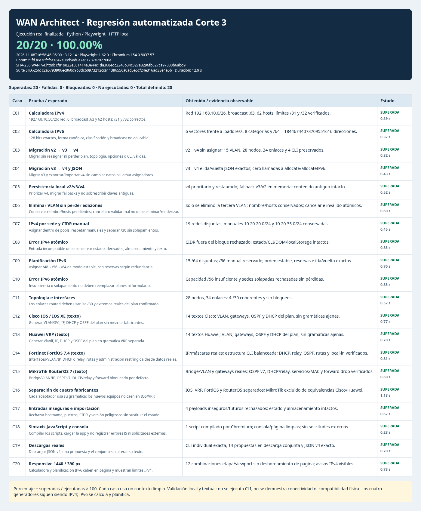

# Pruebas automatizadas de Corte 3

## Resultado y procedencia

**20/20 superadas = 100% del conjunto ejecutado.** Fallidas: 0; bloqueadas: 0; no ejecutadas: 0. No es una certificación física ni una medida de cobertura completa de la aplicación.

- Fecha de la captura/reporte: **2026-11-08T16:58:46-05:00**, zona America/Bogota.
- Repositorio: `Daisy-redeswan/redes-wan-Rodriguez`; rama `test/corte3-regresion`.
- Commit ejecutado de la suite: `fd36e76fcfca1847e08d5ed0a7e61737e792760e`. El commit documental posterior agrega únicamente esta evidencia.
- Base de la aplicación: main en `3ec798f1d75885222340399b3baca3a6505a22bf`; `WAN_v4.html` permanece intacto.
- Entorno observado: Python **3.12.14**, Playwright **1.62.0**, Chromium **154.0.8037.57**, ejecutable `/usr/bin/chromium`; `Linux-6.18.57-x86_64-with-glibc2.41`.
- Tiempo del reporte: **12.9 segundos** de ejecución; aproximadamente **14 segundos** incluyendo captura y cierre del servidor en este entorno.
- Repetición independiente desde un **clon limpio** del mismo commit: **20/20**, con el árbol limpio al terminar y sin scripts/datos externos a ese checkout. No se suma como 40 casos.

La guía exige pruebas ejecutables, porcentaje real y [captura 09](capturas/09-pruebas.png), que deben demostrarse en la sustentación; ver [Guía Docente.html](<requisitos/Guía Docente.html>). Los ejemplos numéricos de la guía no se utilizaron como resultados.

## Instalación mínima

Requiere Python **3.10 o posterior**, el repositorio completo y Chromium. Única dependencia Python directa: `playwright==1.62.0`, fijada en [requirements.txt](../tests/requirements.txt). La instalación puede requerir Internet; **los casos no utilizan servicios externos**.

Desde la raíz del repositorio, preferiblemente con un entorno virtual **fuera del checkout**:

```bash
python -m venv ../wan-corte3-venv
```

Activar en Linux/macOS: `source ../wan-corte3-venv/bin/activate`. En PowerShell: `..\wan-corte3-venv\Scripts\Activate.ps1`.

```bash
python -m pip install -r tests/requirements.txt
python -m playwright install chromium
python tests/test_corte3.py
```

Si Linux informa bibliotecas de sistema faltantes, instalar los requisitos oficiales con `python -m playwright install-deps chromium` usando los permisos de administración apropiados. No se instalan routers, simuladores ni herramientas de red. En esta ejecución ya estaban disponibles Python, Playwright y Chromium; no se instalaron nuevas dependencias.

El runner prefiere Chromium de Playwright. Si no está instalado, utiliza un `chromium`/`chromium-browser` existente; se puede indicar explícitamente `--browser /usr/bin/chromium` o `CHROMIUM_EXECUTABLE`. La ruta y versión utilizadas quedan en el reporte. No requiere Node, pytest, backend ni infraestructura real.

## Ejecución y artefactos

Comando principal:

```bash
python tests/test_corte3.py
```

[El runner](../tests/test_corte3.py) inicia un servidor HTTP exclusivamente en `127.0.0.1`, con puerto libre, y lo cierra automáticamente mediante `finally`. Cada caso crea un contexto de navegador nuevo, estado v4 vacío y localStorage limpio. Fija los datos de laboratorio y el prefijo ULA; no depende de fechas aleatorias para decidir si pasa. Bloquea solicitudes fuera del origen local y verifica errores de consola/página en **cada caso**, no solo en C18. El cierre del puerto se comprobó después de la ejecución.

Imprime cada caso, esperado/obtenido en el reporte, resultado, X/Y, porcentaje, duración y ubicación del HTML. Devuelve **0 solo cuando todos los casos pasan y los artefactos solicitados se generan**; devuelve un código no cero ante fallo, bloqueo de entorno o error de captura. Un navegador ausente produce 0/0 «no calculable», casos bloqueados y salida 1. Bloqueadas/no ejecutadas no entran al denominador ni se cuentan como éxitos.

La ejecución habitual escribe su reporte en un directorio temporal **fuera del repositorio**, cuya ruta imprime; no modifica fuentes ni resultados versionados. Para actualizar explícitamente los artefactos oficiales de esta tarea:

```bash
python tests/test_corte3.py --report tests/reporte-corte3.html --capture docs/capturas/09-pruebas.png
```

El PNG se toma con Playwright **del HTML recién generado** a 1400 px de ancho, sin editar resultados ni componer imágenes. Se renderiza el contenido exacto del reporte con `set_content`, lo que evita depender de navegación `file://` (bloqueada por la política del Chromium de este entorno). El HTML incluye metadatos y registros reales embebidos como JSON, sin archivo JSON intermedio. Se conserva [reporte-corte3.html](../tests/reporte-corte3.html) como fuente auditable de la captura; para verlo en un navegador que bloquee archivos locales, servir el checkout temporalmente por HTTP local. No interpretar HTML/PNG antiguos como resultado de una ejecución nueva.

## Casos y resultados observados

Todos los casos siguientes se ejecutaron en el entorno y commit indicados. Los resultados se transcriben automáticamente del HTML generado por la suite.

| Caso | Esperado | Obtenido / evidencia observable | Estado |
| --- | --- | --- | --- |
| C01 · Calculadora IPv4 | 192.168.10.50/26: red .0, broadcast .63 y 62 hosts; /31 y /32 correctos. | Red 192.168.10.0/26, broadcast .63, 62 hosts; límites /31 y /32 verificados. | Superada |
| C02 · Calculadora IPv6 | 128 bits exactos, forma canónica, clasificación y broadcast no aplicable. | 6 vectores frente a ipaddress, 8 categorías y /64 = 18446744073709551616 direcciones. | Superada |
| C03 · Migración v2 → v3 → v4 | Migrar sin reasignar ni perder plan, topología, opciones o CLI válidas. | v2→v4 sin asignar; 15 VLAN, 28 nodos, 34 enlaces y 4 CLI preservados. | Superada |
| C04 · Migración v3 → v4 y JSON | Migrar v3 y exportar/importar v4 sin cambiar datos ni llamar asignadores. | v3→v4 e ida/vuelta JSON exactos; cero llamadas a allocate/allocateIPv6. | Superada |
| C05 · Persistencia local v2/v3/v4 | Priorizar v4, migrar fallbacks y no sobrescribir claves antiguas. | v4 prioritario y restaurado; fallback v3/v2 en memoria; contenido antiguo intacto. | Superada |
| C06 · Eliminar VLAN sin perder ediciones | Conservar nombre/hosts pendientes; cancelar o validar mal no debe eliminar/renderizar. | Solo se eliminó la tercera VLAN; nombre/hosts conservados; cancelar e inválido atómicos. | Superada |
| C07 · IPv4 por sede y CIDR manual | Asignar dentro de pools, respetar manuales y separar /30 sin solapamientos. | 19 redes disjuntas; manuales 10.20.20.0/24 y 10.20.35.0/24 conservadas. | Superada |
| C08 · Error IPv4 atómico | Entrada incompatible debe conservar estado, derivados, almacenamiento y texto. | CIDR fuera del bloque rechazado: estado/CLI/DOM/localStorage intactos. | Superada |
| C09 · Planificación IPv6 | Asignar /48→/56→/64 de modo estable, con reservas según redundancia. | 15 /64 disjuntas; /56 manual reservado; orden estable, reservas e ida/vuelta exactos. | Superada |
| C10 · Error IPv6 atómico | Insuficiencia o solapamiento no deben reemplazar planes ni formulario. | Capacidad /56 insuficiente y sedes solapadas rechazadas sin pérdidas. | Superada |
| C11 · Topología e interfaces | Los enlaces routed deben usar las /30 y extremos reales del plan confirmado. | 28 nodos, 34 enlaces; 4 /30 coherentes y sin bloqueos. | Superada |
| C12 · Cisco IOS / IOS XE (texto) | Generar VLAN/SVI, IP, DHCP y OSPF del plan sin mezclar fabricantes. | 14 textos Cisco; VLAN, gateways, OSPF y DHCP del plan, sin gramáticas ajenas. | Superada |
| C13 · Huawei VRP (texto) | Generar Vlanif, IP, DHCP y OSPF del plan en gramática VRP separada. | 14 textos Huawei; VLAN, gateways, OSPF y DHCP del plan, sin gramáticas ajenas. | Superada |
| C14 · Fortinet FortiOS 7.4 (texto) | Interfaces/VLAN/IP, DHCP o relay, rutas y administración restringida desde datos reales. | IP/máscaras reales; estructura CLI balanceada; DHCP, relay, OSPF, rutas y local-in verificados. | Superada |
| C15 · MikroTik RouterOS 7 (texto) | Bridge/VLAN/IP, OSPF v7, DHCP/relay y forward bloqueado por defecto. | Bridge/VLAN y gateways reales; OSPF v7, DHCP/relay, servicios/MAC y forward drop verificados. | Superada |
| C16 · Separación de cuatro fabricantes | Cada adaptador usa su gramática; los nuevos equipos no caen en IOS/VRP. | IOS, VRP, FortiOS y RouterOS separados; MikroTik excluido de equivalencias Cisco/Huawei. | Superada |
| C17 · Entradas inseguras e importación | Rechazar hostname, puertos, CIDR y versión peligrosos sin sustituir el estado. | 4 payloads inseguros/futuros rechazados; estado y almacenamiento intactos. | Superada |
| C18 · Sintaxis JavaScript y consola | Compilar los scripts, cargar la app y no registrar errores JS ni solicitudes externas. | 1 script compilado por Chromium; consola/página limpias; sin solicitudes externas. | Superada |
| C19 · Descargas reales | Descargar JSON v4, una propuesta y el conjunto sin alterar su texto. | CLI individual exacta, 14 propuestas en descarga conjunta y JSON v4 exacto. | Superada |
| C20 · Responsive 1440 / 390 px | Calculadora y planificación IPv6 caben en página y muestran límites IPv4. | 12 combinaciones etapa/viewport sin desbordamiento de página; avisos IPv4 visibles. | Superada |

Fórmula aplicada:

```text
Ejecutadas = superadas + fallidas = 20 + 0 = 20
Porcentaje = superadas / ejecutadas × 100 = 20 / 20 × 100 = 100%
Bloqueadas = 0; no ejecutadas = 0
```

Los controles negativos del propio runner se verificaron **por separado**, sin agregarlos al 20/20: una expectativa inicial de C09 produjo 19/20 y salida no cero; una ruta de navegador inexistente produjo salida 1, 20 bloqueadas y porcentaje no calculable; intentar usar `WAN_v4.html` como destino de reporte produjo salida 2 sin modificar la aplicación. La diferencia de C09 fue exactamente el metadato opcional `subnetOK=false` materializado por el importador; se corrigió esa expectativa del test, conservando la comparación del estado completo. El primer intento de captura falló porque Chromium bloqueó `file://`; se corrigió solo el runner, y la ejecución final completa/captura terminó satisfactoriamente.

## Datos de prueba y límites

La fixture [laboratorio-v2.json](../tests/fixtures/laboratorio-v2.json) contiene un laboratorio ficticio v2 con dos sedes, 15 VLAN, 28 nodos y 34 enlaces, más cuatro propuestas Cisco/Huawei de referencia válidas. Se conservaron solo esas cuatro CLI para evitar duplicación innecesaria. La muestra v3 se construye explícitamente desde esa fixture con las intenciones vacías del contrato v3; no se presenta como un archivo v3 histórico independiente. El resto de escenarios se construye desde los flujos actuales de la aplicación y datos de laboratorio definidos en el runner. No hay dependencia de `/workspace/work`, archivos de otra sesión, secretos ni credenciales reales.

La cobertura verifica comportamiento de formularios/estado, cálculos frente a Python `ipaddress`, migración, atomicidad, persistencia, topología y estructura/coherencia de textos CLI. Compila JavaScript en Chromium sin requerir Node. Fortinet se revisa bajo el supuesto FortiGate genérico/FortiOS 7.4 sin VDOM; MikroTik bajo RouterOS 7.x genérico sin VRF/CAPsMAN. No certifica gramática completa, modelos, firmware, forwarding, convergencia, seguridad efectiva, conectividad ni hardware. **Nunca se aplican configuraciones**. Los cuatro generadores continúan siendo IPv4; IPv6 se calcula y planifica, con generación por fabricante pendiente de aclaración docente.

Es una regresión representativa de Corte 3, no una auditoría exhaustiva ni la repetición de todas las matrices históricas. Otros navegadores/plataformas, accesibilidad completa, datos masivos y validación física no forman parte de los 20 casos; siguen pendientes por separado. `saveSite()` y los desbordamientos históricos ajenos a las pantallas verificadas no se corrigen ni se certifican en esta tarea. Las pruebas no justifican modificar producción automáticamente ante un fallo: se debe analizar y pedir alcance adicional si requiere cambiar `WAN_v4.html`.

## Captura 09 y trazabilidad



Se revisó visualmente el PNG: los 20 casos, X/Y, porcentaje, fecha, commit y versiones son legibles. El reporte y la captura corresponden a la misma ejecución; la imagen no fue editada manualmente.

- SHA-256 de `WAN_v4.html`: `cf819822e581414a3e44c1da368edc2246b34c327a8296fb827ca97380b6abd9`.
- SHA-256 de la suite ejecutada: `c2a5793906ec860d9b3dcb0973212cca11386556a0ad5e5cf24e316ad33e4e5b`.
- SHA-256 de la fixture: `ac1b430c4f5cf9034495ada9462571c65810e3f50fc59a0f8fb2187c4a03551f`.
- SHA-256 del HTML de resultados: `ee7f2934df3cb8d1e137ba641753d5c0942225364d4e8c45a7be681f8b197a8a`.
- SHA-256 de la captura 09: `032b942fd24a5bdc0f3ba11d1cf4820678eb4488755f73cfadd4d8678e6acf29`.

## Procedimiento para sustentación

1. Abrir el repositorio/commit, comprobar el entorno instalado y explicar que todas las configuraciones son propuestas de texto.
2. Ejecutar `python tests/test_corte3.py` en una terminal visible; dejar que aparezcan C01–C20 y el resumen real.
3. Explicar el denominador: solo superadas/fallidas ejecutadas; mostrar por separado bloqueadas/no ejecutadas. Si el proceso devuelve no cero, exponer el diagnóstico y no reutilizar una captura anterior como éxito actual.
4. Abrir el HTML recién generado (su ruta se imprime) y contrastar un caso de cálculo, una migración, una eliminación VLAN y una salida por fabricante con esperado/obtenido.
5. Mostrar captura 09 versionada como evidencia histórica de esta ejecución; para evidencia actual, regenerarla con las opciones explícitas anteriores y registrar su fecha/commit.
6. Señalar límites: validación local/textual, generación IPv4 y aclaración docente de IPv6; no conectar ni ejecutar CLI en equipos reales.
